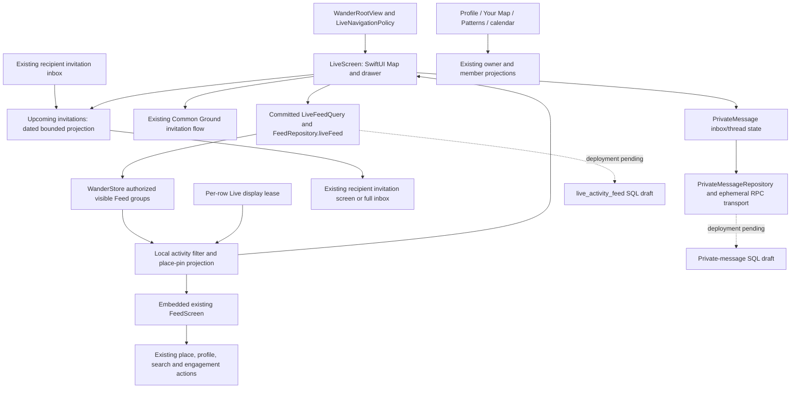

# REC-636 — Live implementation plan

**Implementation in progress · October 11, 2026.** This document describes the integrated app source and the remaining work. Exact native results, captures and outstanding reruns belong in the [integrated validation report](review/integrated-validation.md). Earlier `preview/rec-636-live` evidence does not validate this integration.

## 1. Accepted scope and current boundaries

The locked shell is **Live / Lists / Profile**, with Add as an action. Recent activity retains the existing Feed cards, grouping, engagement actions and **Invite people to Astir → People worth following → Activity** order. Profile retains identity/social, streak, recent activity, full Your Map and calendar. **Only area drawing is reused from Your Map**; Patterns, history, lenses, Snapshot, sharing and owner/member map navigation remain there.

Production private messaging is approved with mutual-only eligibility. Wanna planning reuses the existing invitation flow. D2/D3 query presets/defaults are explicitly accepted: Following starts with seven days; local Nearby now starts at 5 km around an explicitly selected public city center with explicit expansion to 25 km. Category/person/24-hour controls, fixed bounds and the full native query/store contract are integrated; the matching SQL remains unpackaged and undeployed. Current device-location centering is not implemented; selected public city centers remain available. Nearby narrows the existing trusted Feed subset and adds no unrelated public inventory. D9 migration and D10 separation of Upcoming from historical activity are accepted. Drawing uses freehand selection with explicit Apply/Cancel and account-session area retention. D11’s 15-minute Live social display lease is approved and implemented in the Live query projection; Profile/shared-cache policy stays unchanged. Delegated rollout is internal-only, with explicit server account approval required for both private-message participants.

| Area | Implemented source | Remaining boundary |
|---|---|---|
| Shell and routing | `WanderRootView`, `LiveNavigationPolicy`, registered `.unifiedLiveV1`, three visible tabs when enabled; legacy shell retained | Native route/foreground/rollback verification and hosted flag registration before ordinary activation |
| Map and drawer | `LiveScreen` uses **SwiftUI `Map`, `MapReader`, `Annotation` and `MapPolygon`**, plus a custom drawer | It does not embed `NativeMapView`; final gesture, accessibility, small-phone and performance evidence is required |
| Feed integration | Defaulted embedded `FeedScreen` API; current cards/actions/supporting modules retained | Map/filter coverage is the authorized loaded Feed, not all server matches |
| D2/D3 query selection | City-centered 5/25 km, category/person choices, 24-hour range, fixed bounds and committed native query/store integration | SQL packaging/deployment and hosted verification remain required; current device-location centering is not implemented |
| Server-filtered Feed | `LiveFeedQuery`, `FeedRepository.liveFeed` and `SupabaseFeedRepository.liveFeed` exist | Store connection is implemented in `WanderLocalStore.swift`; the full-parameter RPC remains an unpackaged, undeployed SQL draft |
| Private messaging | Models, state/views, ephemeral transport and inactive-scene cover; SQL draft adds an operator-owned account gate for both mutual participants | SQL is unpackaged/undeployed; require real authorization/delivery and privacy evidence before activation. First rollout is internal-only |
| D11 display lease | Approved 15-minute, per-activity Live social authorization receipts and expiry projection | Owner, legacy Feed and Profile/shared-cache policy remain unchanged; validate expiry and authorized renewal on the candidate |
| Wanna planning | `LivePlanPeoplePicker`/policy select existing `CommonGroundLiveData` candidates; existing composer/sharing/repository retained | Verify own and friend Wanna, cold-cache recovery, account changes, cancellation and real invitation create/share/open/inbox |
| Upcoming invitations | Conditional 44-point entry, separate scrollable sheet and queued existing recipient/inbox routes; shared authorized inbox reused | Max three current/future dated received invitations from the latest 100; no complete schedule/sent-plan claim |
| Events | Existing eligible launch-interest destination remains reachable | No full event inventory, booking, RSVP, Event history or new Event deep-link contract is implemented here |
| Migration teaching | Gated card/guide/replay, explicit fresh-orientation semantic acknowledgements, archived-checkpoint Continue/Not now and root recovery routing | Recovery and rollback preserve drafts, permissions and explicit routes; historical missing payloads use explicit fallbacks |

The standard **Live Experience Review** scheme launches the integrated `Wander` target with isolated Simulator fixtures. It is distinct from the old standalone prototype. Its demo messages explicitly say nothing is delivered. See [review guide](review-guide.md) for launch steps.

## 2. Actual source seams

| Source | Responsibility |
|---|---|
| `Wander/Features/Live/LiveScreen.swift` | Presentation state, map/drawer, committed query installation and matching map/Feed projection, selected-place activity chooser, drawing draft, search/notifications/Add/messages/plan entry |
| `Wander/Features/Live/LiveMapPolicy.swift` | `LiveDrawnArea`, `LiveActivityFilter`, `LiveTimeFilter`, density-based `LiveMapCameraPolicy`, `LiveNavigationPolicy` |
| `Wander/Features/Live/LiveBrowseSelection.swift` | Scope/radius/category/person/type selection, fixed bounds, authorized-loaded facet options and conversion to the committed `LiveFeedQuery` |
| `Wander/Features/Live/LiveIntroductionPolicy.swift`, `LiveIntroductionViews.swift` | Account/version presentation store, eligibility policy, optional card/guide and non-mutating semantic checkpoint adapter |
| `Wander/Features/Live/LiveIntroductionOrientationStore.swift` | Explicit fresh-orientation context, account/version-fenced teaching acknowledgements and contiguous primary map/feed progress; default replay remains read-only |
| `Wander/Features/Live/LiveIntroductionMigrationStore.swift` | Account/record-fenced checkpoint archives, semantic acknowledgements, distinct opened/completed/dismissed recovery states and process-only Settings-to-root handoff |
| `Wander/Features/Settings/ProfileSettingsViews.swift` | What's changed replay in the existing Settings home when Live is enabled; Profile structure unchanged |
| `Wander/Features/Feed/FeedScreen.swift` | Existing Feed plus `isEmbedded`, optional `filteredActivityIDs`, `FeedActivityFocusRequest`, `FeedSurfaceRequest` and optional `onPrivateReply`; old initialization stays compatible |
| `Wander/Services/WanderLocalStore.swift` | Integrated `liveFeedQuery`/`selectLiveFeedQuery`, account/audience/query request fences, bounded Live paging and per-row display leases; nil query retains legacy behavior |
| `Wander/Services/LiveFeedQuery.swift` | Immutable time/type/polygon/center/radius/category/person value; validation, canonical viewer category and fixture/presentation parity |
| `Wander/Services/LiveFeedDisplayLease.swift` | Session-only per-activity authorization receipts, 15-minute social expiry and owner exemption |
| `Wander/Services/RepositoryProtocols.swift` | Additive `FeedRepository.liveFeed(audience:query:before:limit:onContent:)`; default implementation fails explicitly rather than filtering a legacy page |
| `Wander/Services/Remote/SupabaseRepositories.swift` | Live RPC parameter encoding and existing staged text/media decoding; legacy Feed APIs remain |
| `Wander/Models/PrivateMessageModels.swift` | Typed context, participants, summaries/messages, opaque cursors, pending state and safe errors |
| `Wander/Features/Messaging/` | Memory-only inbox/thread state, composer, retry and source/profile navigation; Simulator fixture repository is explicitly simulated |
| `Wander/Services/Remote/PrivateMessageRepository.swift` | `PrivateMessageRepository` and `SupabasePrivateMessageRepository` for start/read/list/send/mark-read operations |
| `Wander/Services/Remote/PrivateMessageRPCClient.swift` | Allowlisted RPCs, ephemeral session/no URL cache or cookies, account fencing and safe error mapping |
| `Wander/Features/Live/LivePlanPeoplePicker.swift` | Mutual-person selection and authorized existing-plan candidate resolution; no invitation is sent by selecting a person |
| `Wander/Features/Profile/CommonGroundInvitationDraft.swift`, existing invitation composer/sharing and `PlacePlanInvitationRepository` | Existing deliberate create/share/open/inbox lifecycle |
| `Wander/Features/Live/LiveUpcomingInvitationsView.swift`, `Wander/Models/PlacePlanInvitation.swift` | Bounded account/failure-fenced projection, suggested-date decoding, max-three presentation and route callbacks; no new store or RPC |

There is no implemented `LiveModel`, `LiveRepository`, `LiveResult` or `LiveRouteAdapter` type. Those earlier illustrative names are superseded by the seams above. Views continue to use store/repository boundaries rather than calling hosted services directly.

## 3. Integrated query and undeployed server contract

### Current runtime

`LiveScreen` commits `LiveBrowseSelection.query(area:)` through `WanderStore.selectLiveFeedQuery(_:)`. The store uses `FeedRepository.liveFeed` for a non-nil query, fences responses by account/audience/query/request identity, and fetches one bounded server page per explicit load action. Query changes cancel/reset paging; ordinary tab return retains the selection. Nil restores the legacy API. [The historical store patch](implementation-drafts/store.patch) has been applied and extended; current `WanderLocalStore.swift` and `LiveFeedStoreTests.swift` are authoritative. Do not reapply that patch.

Map pins and embedded Feed share `store.visibleFeedActivityGroups`, including the Live display lease. `LiveFeedQuery.includes` remains the deterministic fixture filter and final presentation guard, not a production fallback for a missing RPC. Missing backend capability stays a visible failure. The SQL is still unpackaged/undeployed, so integrated native wiring does not establish working hosted paging.

The visible count is **“N updates shown”**, with accessibility label **“N loaded updates”**. It counts matching loaded activity records, not all server matches or unique places. Preserve Load more, stable grouping/engagement identities and existing Feed cards/order. Unmapped records remain in their ordinary card position when no geography/category constraint requires a place. Full history, owner saves, calendar and Snapshot remain in Profile.

The large filter sheet stages audience, type, 24-hour/7-day/30-day/all-time range, city/radius, categories/people and drawn-area removal until Apply. Nearby starts at 5 km with explicit 25 km selection around the visibly selected public `HomeMetro`; it does not request device location or change account home. Cancel preserves the committed query; Reset retains audience. Drawn geometry intersects radius. Apply or explicit refresh advances fixed time bounds; initial loading, pagination and tab/detail return do not. Facet options derive only from already authorized loaded rows.

### SQL prepared, not deployed

[Live Feed SQL draft](implementation-drafts/live-feed.sql) adds `app.live_feed_polygon` and `app/public.live_activity_feed`, preserving legacy `activity_feed`/`followed_feed`. Its parameters include audience, inclusive `input_after`/`input_until`, activity type, polygon, cursor/limit, `input_center_latitude`, `input_center_longitude`, `input_radius_meters`, `input_category_ids` and `input_person_ids`. Radius requires all three values, a finite WGS84 center and 100–25,000 metres. Each refinement array is limited to 100 values; empty means no refinement, and duplicate/order differences normalize to the same set.

Every predicate runs before `(occurred_at, id)` keyset pagination. The cursor fingerprints viewer, audience, time, type, polygon, center/radius and normalized category/person sets. It is scope binding, not authorization: each call reevaluates existing Feed actor/source/visit/list policies, bilateral blocks and current access. Limits remain 1–50. Radius uses the existing PostGIS geography with `ST_DWithin`; polygons and radius intersect. Nearby never adds stranger visibility. Legacy `place_saved` classification and list-only records retain their existing semantics. No transaction-wide snapshot or total count is promised.

Categories use `app.viewer_place_taxonomy`: the viewer’s override, frozen snapshot or canonical global fallback, never the source actor’s private override. Every Live place carries its normalized canonical viewer category attribute; `LiveFeedQuery.categoryID(for:)` consumes that value so provider heuristics cannot discard server matches. Legacy Feed/Profile projections are unchanged. Person refinement matches activity actor IDs.

Committed times normalize to wire milliseconds. Polygon validation accepts 3–512 finite vertices, checks degeneracy/intersections, unwraps the dateline and rejects ambiguous spans of 180° or more. Narrow ±179° shapes remain valid. Swift/store tests and the expanded SQL suite cover independent pre-limit filters behind 60 newer nonmatches, combined paging, canonical taxonomy/privacy, invalid inputs, dateline and query/account cursor mismatches.

SQL migration packaging remains pending. Required gates remain migration/source review, schema/grant metadata assertions, rolled-back SQL regressions, hosted smoke and measured query plans. No hosted execution or activation is asserted. Current device-location centering is not implemented; selected-city centers work.

## 4. Map, drawing and retained content

Keep one SwiftUI map mounted across drawer modes. Camera framing uses authorized loaded density and a home-area anchor when available; after manual pan, new results must not recenter it. Camera movement alone does not change the committed area or fetch a new query. Nearby commits a 5 km radius around the selected public city center, with explicit expansion to 25 km. A drawn polygon intersects that radius independently; viewport changes and panning do not change the query or broaden its authorized audience.

Drawing keeps a draft separate from the committed area, pauses map pan during tracing, previews before Apply, and provides Cancel/Clear and a visible-area alternative. Geometry uses `MapReader` conversion. Retention is session-only and clears on account change. Do not persist coordinates across devices or create a Snapshot/list from drawing. Freehand Apply/Cancel and account-session retention are the implemented interaction.

The drawer implements peek/half/full with direct handle drag and a VoiceOver adjustable action. Root tabs currently stay visible at every detent, and full height exits through the same handle; no floating Map pill or count-tap button is implemented. The prior target hid tabs at peek and added a Map pill at full height, so those differences remain explicit review items. Preserve safe map attribution, keyboard/large-text behavior and existing Feed cards/actions/order. The final UI pass must verify scroll/drag arbitration, reduced motion, hidden-control hit testing, selected pin → exact activity/place → return, overlap choices and tab/map exits. A successful build alone does not prove these interactions.

Your Map, Patterns, lenses, historical filters, Snapshot, sharing, calendar and current Profile section order are retained. Live does not borrow a truncated Feed page as owner history. The legacy main Map may still render compatibility place/search destinations in a root sheet; this is separate from the SwiftUI map mounted in Live.

## 5. Navigation, account boundaries and migration

The flag-enabled shell keeps the raw `.discover` identity for Live and maps legacy Map/Events/Add tab selections through `LiveNavigationPolicy`. Add remains its existing presented flow. `WanderRootView` owns root handoff/reset/presentation lifecycle; `LiveModalLifecycle` registers Live sheets so ordinary foreground entry preserves active conversations and invitation drafts.

| Incoming intent | Current integration / required payload preservation |
|---|---|
| Feed / ordinary entry / notification `.discover` | Live using `.discover`; explicit routes and active flows retain priority |
| Plain legacy Map | Live; keep preference semantics until an explicit translation exists |
| Map search / shared place / place notification | Existing `MapScreen` compatibility sheet with original search/place payload |
| Activity comments | Original activity ID into existing engagement navigation; expand hidden Feed drawer before showing it |
| Check-in comments | Preserve both user-place and visit IDs; resolve existing visit-to-activity route |
| Quick capture, Add search, nearby widget candidate, reservation, imports | Existing typed Add/import routes and original draft/input; widget validity checks remain |
| List / list invitation | Existing Lists route, original ID/token and membership checks |
| Profile / people / drafts / calendar | Existing Profile route and mode/date/job payload; no Your Map relocation |
| Plan invitation / shared visit | Existing token or participant ID **and generation**, never a tab-only substitution |
| Owner/member Your Map and Patterns | Existing Profile hierarchy, authorization and return context |
| Future Event links | Separate Events contract; no new working URL is claimed |

If a notification arrives while a Live modal is mounted, root copies the full request and account, consumes the shared request, requests physical dismissal, and republishes the exact destination only after handoff completes. This happens before import-review and other destination-specific branches. Beginning/cancelling a different handoff clears the old queue; account mismatch prevents replay. Tests must exercise every destination, including the shared-visit generation, people mode and full import batch set. Background/foreground is not an implicit cancel/send.

Live's account-change reset clears source/queued plan, people-search intent, conversations, filters/events/drawing and selected-place state. Picker/network callbacks must fence viewer/auth/request generation. Deep-link resets clear queued follow-on presentation before dismissal callbacks, so a cancelled plan picker cannot reopen an old composer.

`.unifiedLiveV1` is the actual registered client flag, default off. The review scheme has an isolated Simulator launch path; it is not ordinary remote rollout. Before activation, align hosted flag registration and verify override/next-launch/rollback behavior. Keep legacy screens and old backend APIs compatible. No data rewrite, follow-edge creation, visibility expansion or destructive migration is required by the shell change.

D9 uses `LiveIntroductionContext`/policy at root to gate on active Live, validated account and existing modal/route/save blockers. The general card records actual presentation and offers Show me/Not now. First-visit eligibility selects Welcome to Live; returning users receive migration copy. The six-step guide explains existing surfaces; anchored spotlights are not implemented. Ordinary full-guide replay writes no legacy progress. The separate resumed migration itinerary acknowledges represented targets only on explicit Next/Done.

Fresh first-visit presentation supplies `LiveIntroductionOrientationContext` to the guide; its default nil context keeps ordinary replay read-only. `LiveIntroductionOrientationStore` persists explicit Next/Done acknowledgements for represented primary map/feed targets and advances only contiguous progress without rewinding newer state. The guide retains its originating account and checks the current authenticated/store account on each acknowledgement. Unavailable authentication, a mismatched version, active or unreadable checkpoint/recovery records and corrupt acknowledgement data refuse writes. No synthetic checkpoint, real-action completion, import/device lesson or permission change is created. Successful acknowledgement notifies the existing root reconciliation hook. Partial/closed/skipped orientation remains incomplete, so rollback may still teach its unacknowledged steps.

`LiveIntroductionMigrationStore.capture` archives the unchanged checkpoint before clearing its active legacy slot, retaining superseded archives by record ID. This is logical UserDefaults ordering, not an fsync/crash-durability guarantee. Required guide targets respect existing progress/completion; acknowledgements advance only represented contiguous progress. Unknown/unmapped required targets cannot silently make a record complete. Continue/Not now and Settings resume are integrated; explicit tutorial dismissal is distinct from domain completion and preserves drafts/permissions.

Root `resumeLiveMigration` waits for physical dismissal through the existing handoff, then fences account and record identity and routes ordinary Add/save/import/search/Profile/Lists/place destinations. Save recovery reuses `PlaceSaveDraftRecoveryPolicy`; only matching commit evidence permits confirming and clearing a committed draft. It does not automatically resubmit. Valid ordinary draft retention remains in force; Live migration bypasses the tutorial-only 12-hour discard. Contacts retain selection without forcing a permission request or send; device acknowledgment marks only its lesson. Flag rollback keeps captured accounts on this recovery bridge rather than invoking legacy forced retirement.

Exact historical limitations: missing full save forms open Add with the old place name, without reconstructed note/date/photos; absent list/editor IDs open Lists; unavailable saved-place detail opens Profile with explanation. Opening any of these keeps recovery incomplete. Users may explicitly dismiss the old tutorial reminder without claiming domain success. Required recovery coverage includes fresh-signup and interrupted journeys, ordinary draft/permission/explicit-route restoration, force-quit/relaunch and flag rollback. Candidate-specific evidence belongs in the validation report.

## 6. Connection journeys

### Existing invitations

Own Wanna opens the mutual-person picker. Friend Wanna retains that actor as the intended partner, hydrates authorized profile data when the direct Common Ground candidate is absent, and resolves the same canonical place. Candidate evidence distinguishes current Wanna from a fulfilled historical snapshot; viewer Been plus partner Wanna is a valid friend-origin case. If existing invitation eligibility cannot be established, show an explicit recovery path to the existing place/save experience rather than fabricate a candidate or share success.

The actual path uses `CommonGroundInvitationDraft`, `CommonGroundInvitationMockup`, `CommonGroundInvitationSharing.prepare` and `PlacePlanInvitationRepository`. Selecting a person creates/sends nothing. Creation deliberately uploads the existing share artwork and produces an invitation to explicitly share; it is not a private message, RSVP, booking, attendance or acceptance. Keep original Wanna/visit identities and cancellation behavior. Do not automatically retry an unknown invitation-create outcome without an idempotency/status-recovery contract.

D10 now reuses `PlacePlanInvitationInbox` and `PlacePlanInvitationRepository.receivedInvitations()`. The existing [RPC payload](../../../supabase/migrations/20260918070816_place_plan_notification_inbox.sql#L14) already includes `suggested_at`; `PlacePlanInvitationPayload.suggestedAt` decodes it optionally and its initializer defaults to nil for older callers. `LiveUpcomingInvitationsProjection` selects dates at or after now, sorts by date then UUID, rejects account mismatch/failed refresh, and exposes at most three visible rows. The inbox remains memory-only with its existing account reset, foreground/push/periodic refresh and failed-refresh clearing. The new view reevaluates dates every minute.

The existing RPC enumerates only the signed-in recipient's latest 100 active invitations by creation time. It checks expiry, deleted accounts and bilateral blocks through its established deliberate-share contract; this is not the new mutual-only messaging contract. Do not parse `dateLabel`, substitute creation time, infer acceptance or claim all upcoming plans. The conditional 44-point Live entry opens a dedicated scrollable sheet. Row/full-inbox actions queue until physical dismissal; rows then use `PlacePlanInvitationScreen(invitationID:repository:analytics:onOpened:)`, which revalidates access, with guarded `markOpened` after successful opening. Account/reset clears all queued presentation. No schema, RPC, WanderStore or Feed change is needed for this slice.

### Private messages

Actual types are `PrivateMessageContext`, `PrivateConversationSummary`, `PrivateMessage`, `PrivateConversationCursor`, `PrivateMessageCursor`, `PrivatePendingMessage`, `PrivateMessageInboxState` and `PrivateMessageThreadState`. Source context refers to an activity/place; no implemented Event-context contract is claimed. `SupabasePrivateMessageRepository` is injected through `WanderBackend`.

Client state is memory-only. Send captures a stable client UUID and normalized body; unconfirmed retries reuse that identity, and acknowledged messages replace pending state only after conversation/sender/client/body checks. The UI distinguishes Sending, Not confirmed and server-acknowledged Sent; it does not claim delivery or read receipts. Mark-read is an advisory watermark, not proof that the recipient saw an outgoing message. Draft/pending state is preserved while the same mounted sheet survives an interruption; no durable offline outbox is implemented.

The allowlisted ephemeral RPC transport checks the authenticated account before/after work, avoids URL caching/cookies and maps errors without exposing raw bodies. Inbox rows, conversations, drafts and quoted context use replay masking. An inactive-scene privacy cover is implemented in both messaging screens. Validate actual app-switcher snapshots and SDK replay output against the candidate; results belong in the integrated validation report. Profile actions provide existing block/report entry. Implemented controls do not establish that hosted policies are active or replay output is safe.

[Private-message SQL draft](implementation-drafts/private-contextual-messages.sql) defines private conversation/message tables and narrow authenticated RPCs for starting, reading, paging, sending and marking read. It requires explicit operator-owned `unified_live_v1` Boolean account overrides for both participants and rechecks mutual eligibility, bilateral blocks and context access; sender-scoped client IDs provide idempotency, conflicting replays fail, and quotas bound creation/send. Current draft reads suppress messages tied to inaccessible source context; contextless follow-on messages have their own mutual/member access check. Source loss must never reveal a private preview through inbox counts or latest-message copy. Global enablement and device overrides cannot substitute for participant approval. Revoking either account override hides the thread and denies subsequent history, send, retry and read operations; tests cover restoration without duplicate messages.

The SQL is not a deployed schema. Required gates: additive migration packaging, source-schema/grant review, `supabase/tests/private_contextual_messages.sql`, rolled-back hosted smoke, real two-account mutual/block/source-revocation/idempotency tests, safe analytics and actual replay inspection. The delegated initial rollout is internal-only after access/privacy checks. Message-specific notifications, reporting/moderation, deletion/retention and operational recovery remain broad-rollout gates; no new retention behavior is inferred from the draft. Soft-deleted accounts lose access but stored messages remain until physical deletion. Review-scheme fixtures show **Demo messages · nothing is delivered** and **Simulated** acknowledgements.

## 7. Cache and privacy boundary

D11’s 15-minute Live social display lease is approved and implemented by `LiveFeedDisplayLease` and the Live-query store projection. Successful authorized page reads create session-only receipts for the returned other-person activity IDs using a monotonic authorized-response receipt, before media work, not a cached payload timestamp. Pagination renews only newly authorized rows; it does not extend older pages. At 15 minutes, social rows without a current receipt disappear from the common map/Feed projection and Live offers a reconnect/refresh explanation. A timer and foreground reevaluation enforce expiry; a successful new authorized read is required to show expired social rows again.

The lease uses `ContinuousClock.Instant` and starts on the authorized content response, before image/signing work. Device suspension counts toward expiry; changing the wall clock cannot extend a receipt. Delayed media and paging regressions exercise this boundary. An embedded empty page retains the existing Load more/retry controls when the server cursor survives local privacy filtering.

Owner rows are exempt under the existing authenticated offline policy. Query/audience/account resets clear receipts; no lease is persisted to disk or applied to legacy nil-query Feed, Profile, calendar, member-map or canonical owner caches. Known local block/deletion/access signals retain immediate invalidation. The lease bounds retained Live display; it cannot detect an unseen remote revocation instantly and does not create a broader shared-cache policy.

Server authorization remains authoritative for records, media, counts, context and source detail. Nearby/drawing narrow permitted records; they never grant stranger visibility or continuous location. Avoid messages, notes, raw searches, coordinates, vertices, names, recipient IDs and tokens in analytics/logs. New successful message analytics and replay masking require their own contract checks. Monetization remains unchanged.

## 8. Events boundary

Live retains the existing market-eligible Events interest entry. Home metro is an account access input, not device GPS or map viewport. Interest signup is not an RSVP. D10's bounded received-invitation presentation is integrated separately; full Event discovery and a complete plan calendar are not implemented by that slice.

Full Event discovery/history remains governed by `docs/designs/astir-events/engineering-handoff.md`, `engineering-contracts.md` and `implementation-tasks.md`. T16 depends on T07 publishing/location controls and T13 canonical history, with T17 integration evidence. Approximate/exact home location, admission versus attendance, private feedback and recap media retain their existing authority gates. Do not duplicate check-ins or treat the Event transactional outbox as a direct-message backend.

## 9. Validation and next work

The [integrated validation report](review/integrated-validation.md) is the single authority for candidate identity, commands, results, captures and outstanding checks. The table below defines required coverage, not completed validation. Native store/query/lease integration exists; backend drafts remain unpackaged, undeployed and unexecuted. Native results do not substitute for hosted access/delivery, actual replay, hardware or rollback evidence.

| Area | Source/suite to use | Required evidence |
|---|---|---|
| Feed continuity | `FeedIntegrationTests`, existing Feed audience/models/pagination and engagement suites | Exact cards/actions/module order, default init compatibility, filtered grouping, empty page continuation |
| Geometry and camera | `LiveMapPolicyTests`, `LiveFeedQueryTests` | Dateline, boundary, invalid/wide shapes, manual pan before/after first page, same loaded IDs |
| Local scope and facets | `LiveBrowseSelectionTests` plus integrated filter UI tests | Fixed bounds, radius/city/facet semantics, cancellation/reset, continuity and loaded-results wording |
| Plans | `LivePlanPeoplePolicyTests`, existing Common Ground/invitation suites | Own/friend Wanna, viewer Been, canonical aliases, no-owner-save recovery, block/account switch, real invitation result |
| Upcoming invitations | `LiveUpcomingInvitationsTests`, existing recipient repository/inbox suites, integrated route UI checks | Optional dates, stable sort/max-three display, account/failure/clock fences and existing authorized opening |
| Messages | `PrivateMessageRepositoryTests`, `PrivateMessagingStateTests`, `PrivateMessageRPCClientTests` | Stable retry ID, duplicate/conflicting acknowledgements, account/reset/late completion, suspended token/network cancellation, one 401 retry with identical body, ephemeral transport and replay masking |
| Server Feed | `supabase/tests/live_activity_feed.sql` and hosted smoke harness | Authorization parity, filters before limit, cursor/query/account mismatch, tied timestamps, shape boundaries and grants |
| Server messages | `supabase/tests/private_contextual_messages.sql` and hosted smoke harness | Operator-owned approval/revocation/restoration for both participants, mutual-only access, source loss, blocks, forged receipts/context, idempotency, quotas and private grants |
| Store query integration | `LiveFeedStoreTests`, `LiveFeedQueryTests`, `LiveFeedDisplayLeaseTests` | No cross-query/account publication; cancel/append/retry; Profile/calendar/Your Map state preserved |
| Root compatibility | Existing navigation/foreground/flags/NUX suites plus Live cases | All route payloads, modal dismissal/notification replay, fresh/returning signup, rollback and no stale account queue |
| Introduction | `LiveIntroductionPolicyTests` plus integrated UI/NUX checks | Fresh/recovery journeys and force-quit/relaunch/rollback, including ordinary drafts, permissions and explicit-route restoration |
| Native review | `LiveExperienceUITests` and retained Profile/Your Map suites | Current/smaller phone, light/dark, VoiceOver, large text, reduced motion, keyboard, real drag/scroll and draft interruption |
| Analytics/release | Repository analytics checks and full relevant native suite | Safe event cardinality, actual replay proof, final candidate evidence and ordinary release gate |

Use the shared **Live Experience Review** scheme to inspect the integrated target. Generate project changes through XcodeGen. The implementation owner records commands, destination, build/commit, results and gaps; do not copy old standalone captures into current evidence.

Proposed performance acceptance targets remain targets, not measured behavior: smooth 60 fps drawer/map interaction, bounded server page size, no query per camera pan, responsive first text independent of media, and a stable memory plateau under repeated filters/paging. Measure against the existing app on a smaller and current phone. Any future retained-window cap or fill budget must be explicit and must evict map/list records together; it is not delivered by the current code merely because it was proposed earlier.

Next work, in order:

1. Review the final integrated captures and resolve or isolate outstanding full-suite/legacy Feed failures while preserving exact Feed/Profile behavior.
2. Package and validate the full-parameter Live SQL through the migration workflow before hosted-query or activation claims.
3. Package/validate messaging SQL and real two-account behavior, including operator-owned participant approval/revocation; restrict the first rollout to internal testers. Resolve abuse/retention and operational gates before broader activation.
4. Validate D9 fresh-orientation semantic progress and integrated recovery/rollback paths, including read-only replay, partial acknowledgements and explicit missing-payload destinations. Validate the integrated D10 received-invitation slice; keep existing Events interest functionality until its separate discovery dependencies are ready.
5. Complete flag registration, next-launch rollback, full native/hosted/analytics validation and reviewed device evidence before a controlled rollout. D11 is approved only for the implemented Live display lease; broader cache changes are outside scope. Current device-location centering is not implemented; selected-city centers work.

Targeted native passes do not establish hosted deployment, production activation or release readiness. Hardware, privacy and host recovery journeys retain their own validation gates. Profile/Your Map remains supported in both shell configurations.
