# Integrated Live review captures

REC-636 · V12 final native candidate · Current integrated app candidate

These 14 images were selected from completed large and compact simulator runs of the normal Wander target. All 11 Live UI cases passed on each device. Both runs match the same frozen Swift and project-input hashes; the exact device, capture time, test and original/review image hashes are in [capture provenance](integrated/capture-provenance.json).

Tested checkout: `f3f08b3dd0a058eab4f0eecd9494b01e4846110b` on `codex/live-experience-review`, plus the frozen source manifest. The commit alone does not identify uncommitted tested changes. Xcode: 26.6 (iOS 26.5 Simulator); signing: Ad-hoc Simulator signing.

These are compressed complete-screen review copies. Originals, recordings and result bundles remain in `/private/tmp/rec636-evidence/`. This gallery replaces the V4 review copies; V4 remains historical evidence in its original bundles and Git history. The [standalone prototype captures](captures.md) are separately historical and do not show this implementation.

The fixtures are fictional. Messages and invitation rehearsals do not deliver to another person; the messaging UI labels acknowledgements Simulated. Settings guide replay is optional. Stills do not establish hosted authorization/delivery, production query execution, spoken VoiceOver order or hardware gestures. See the [review guide](../review-guide.md) and [validation record](integrated-validation.md) for those boundaries.

## Live landing · large phone

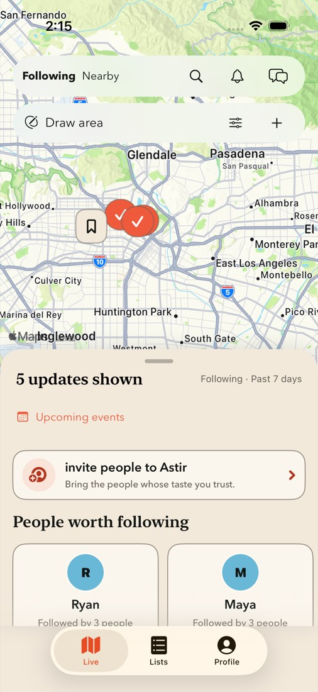

## Live landing · compact phone

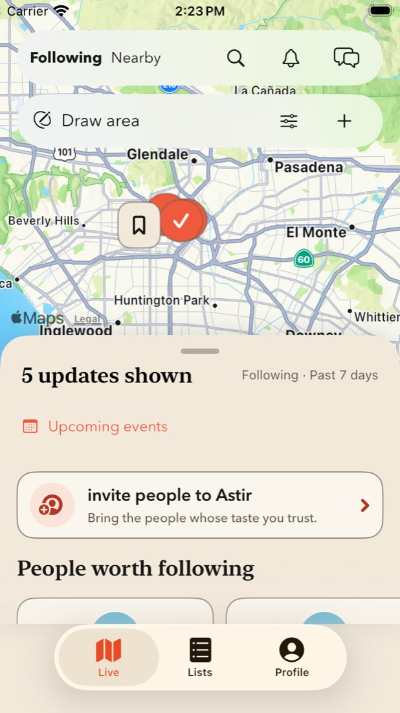

## Expanded drawer · existing Feed modules

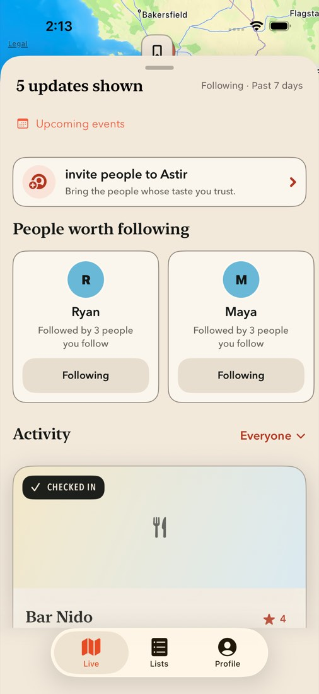

## Existing activity card · compact phone

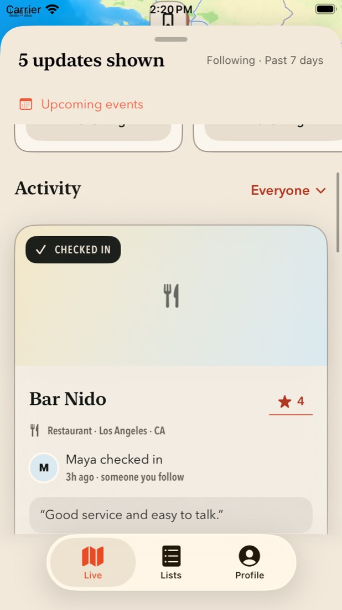

## Drawing review · largest accessibility text

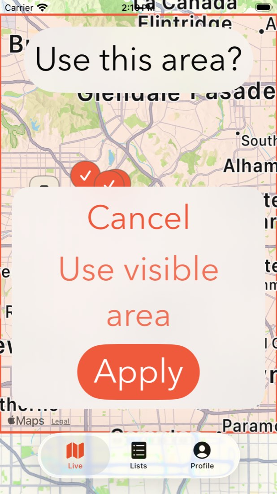

## Staged Nearby radius

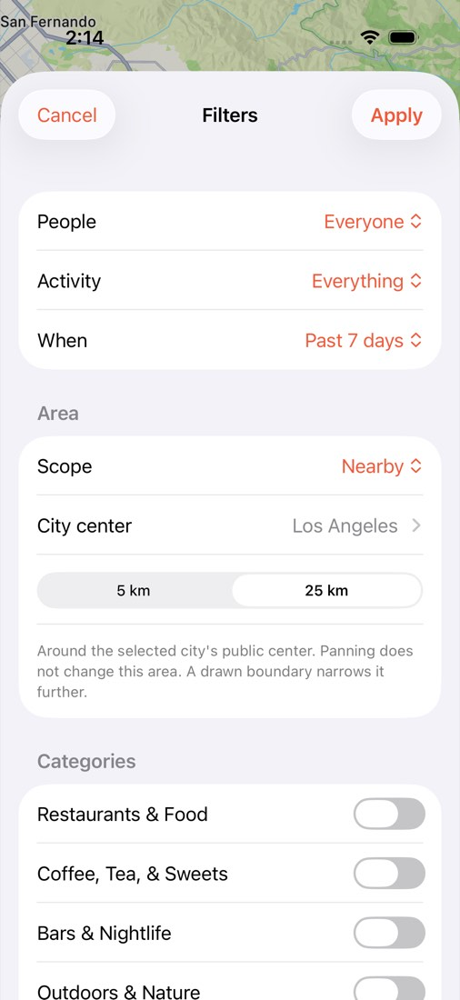

## Wanna → contextual private reply

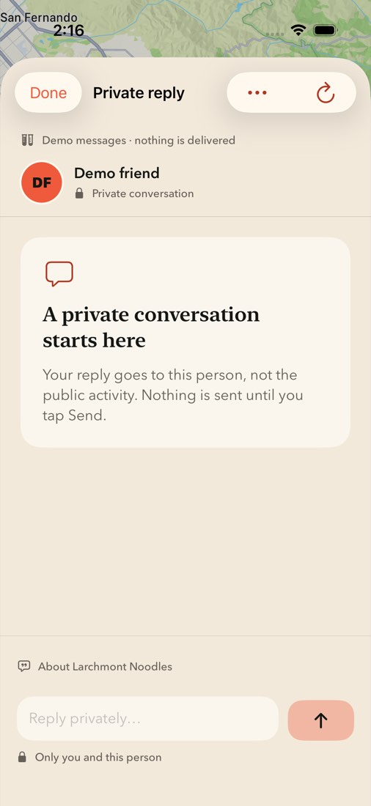

## Private reply · compact keyboard

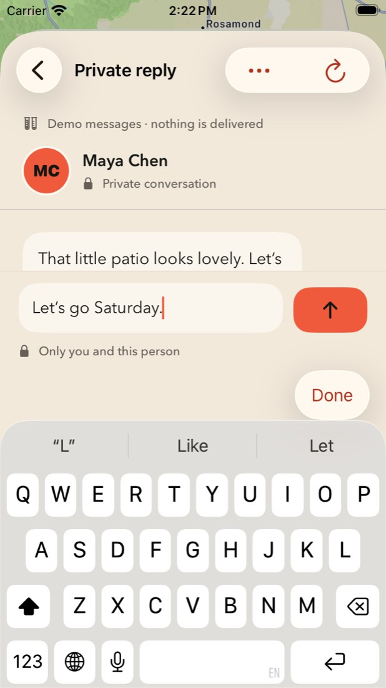

## Existing plan invitation editor

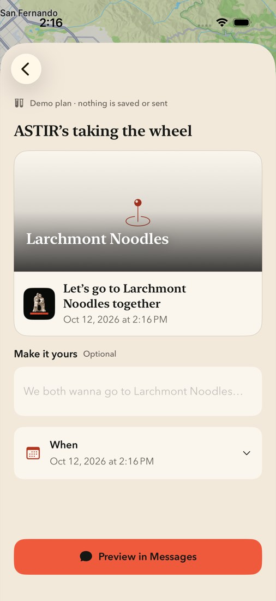

## Invitation rehearsal preview

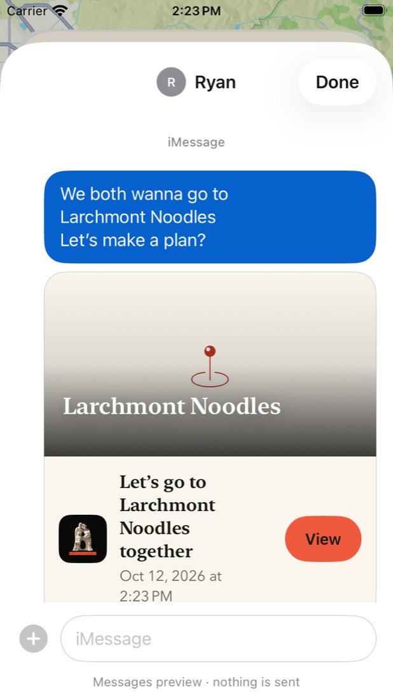

## Upcoming received invitations

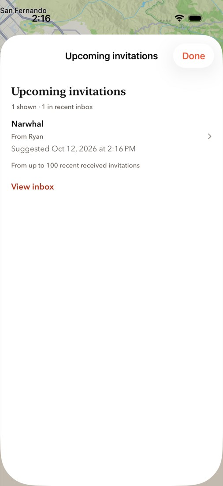

## Existing invitation recipient

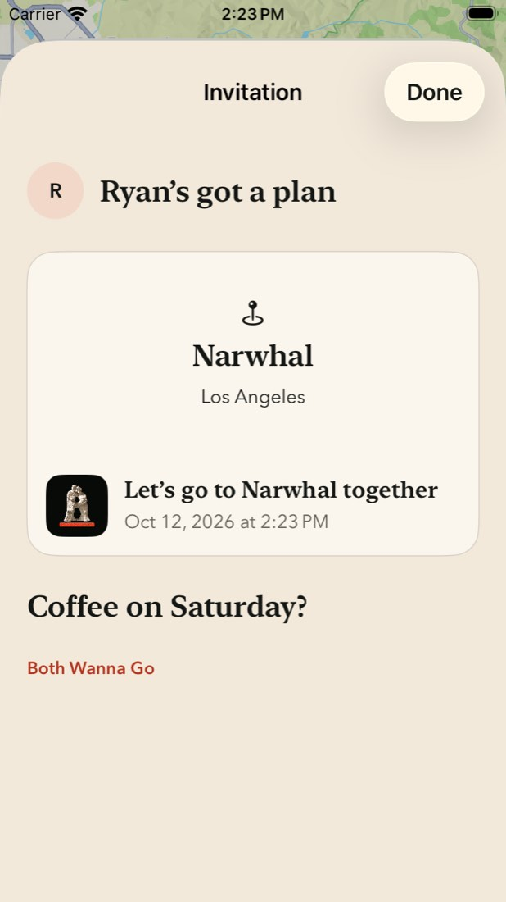

## Profile continuity

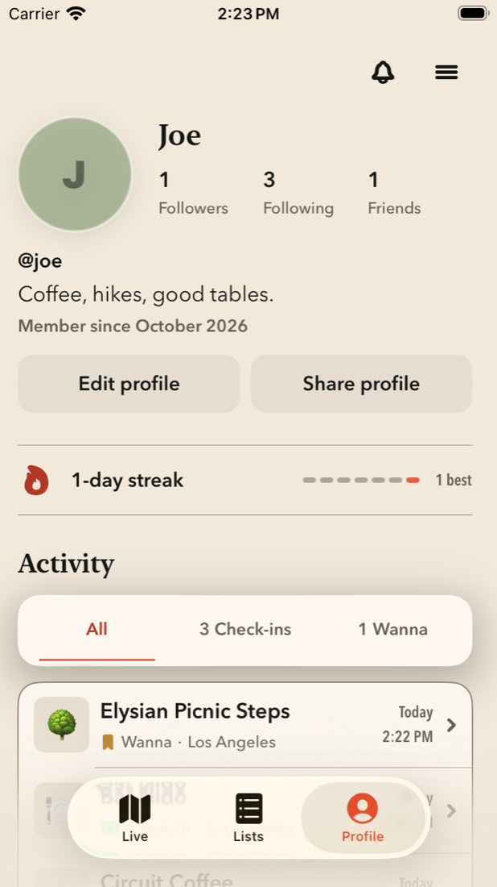

## Settings guide replay

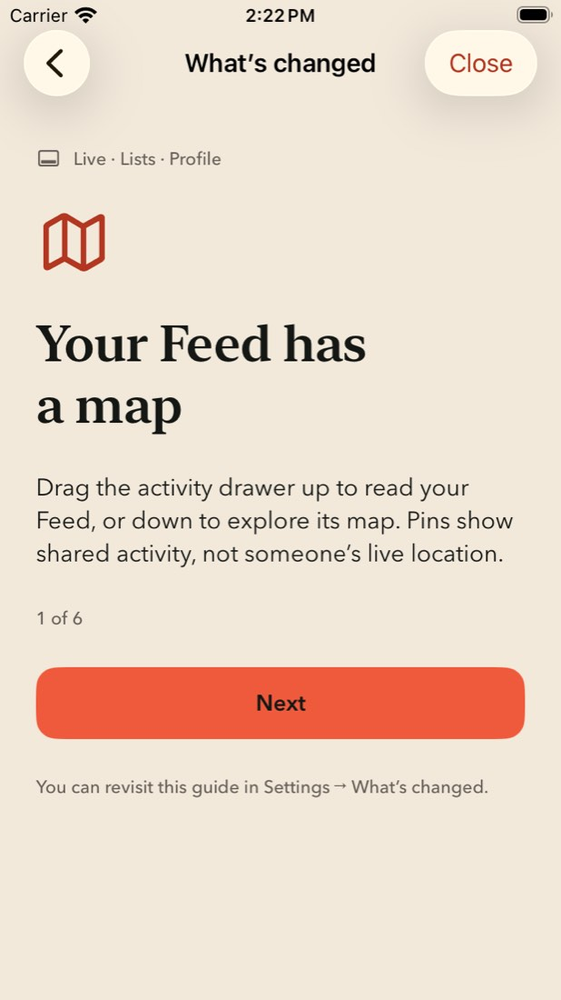
