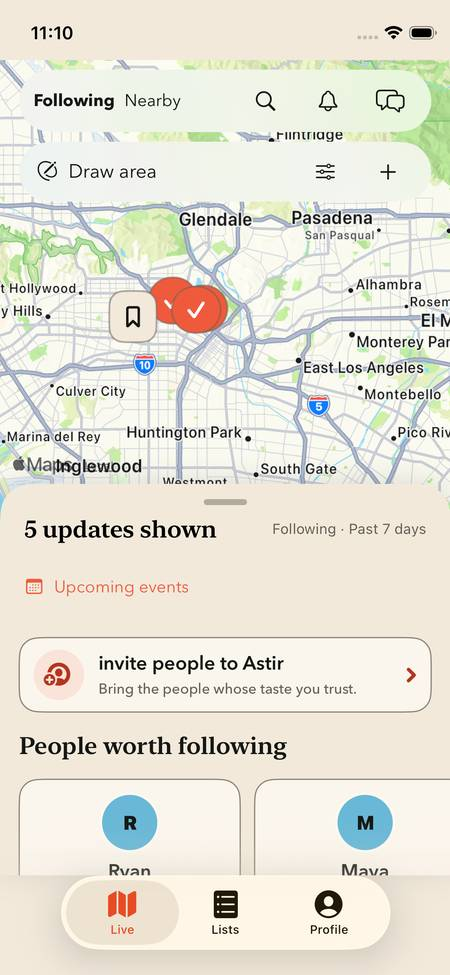
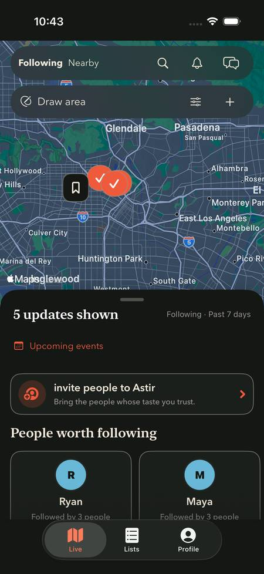
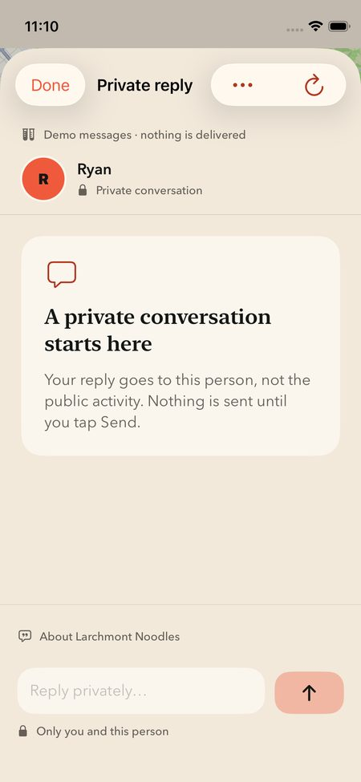
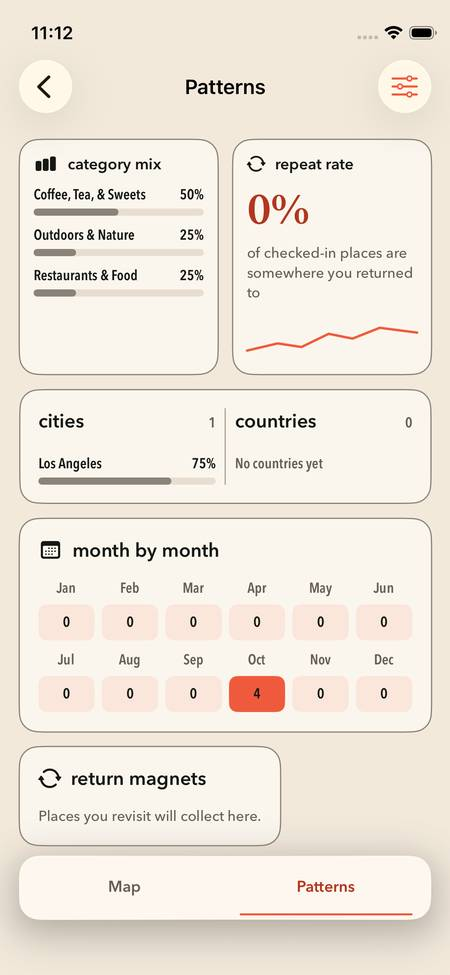
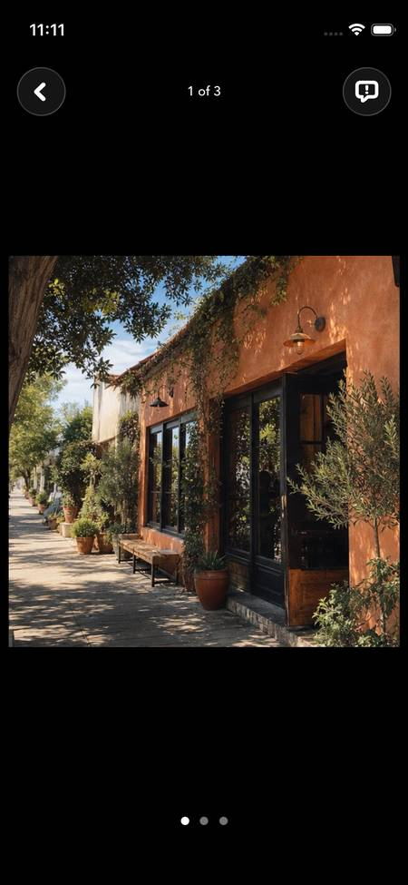
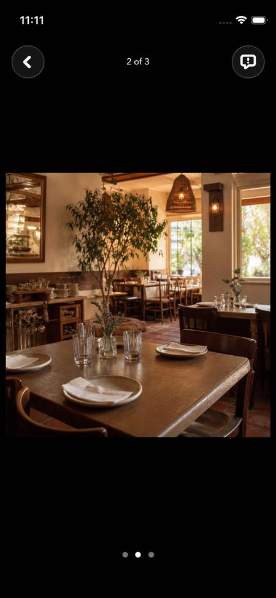
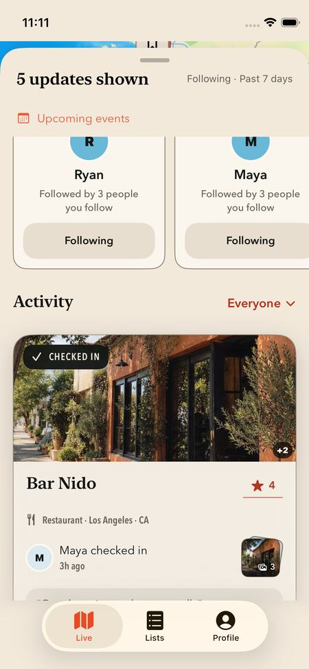
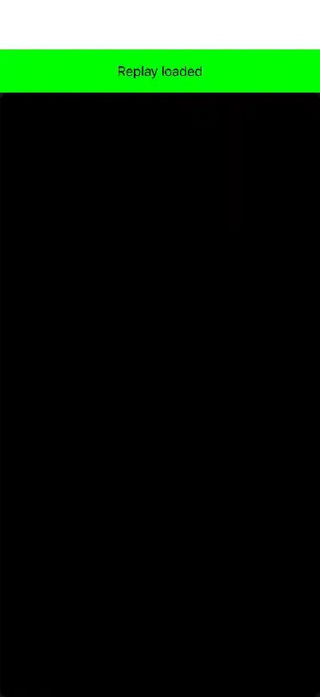
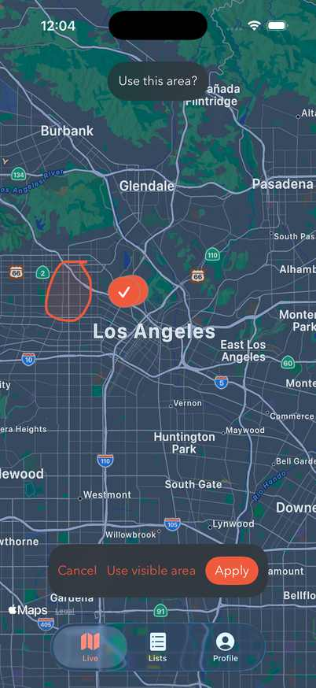
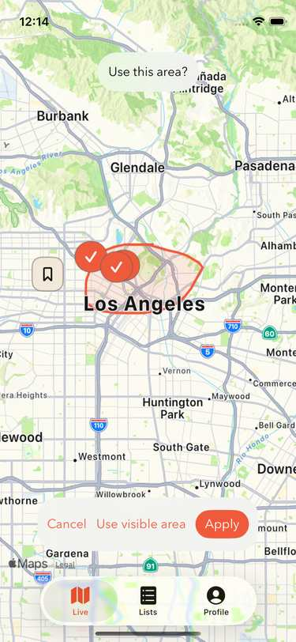

# Integrated Live review captures

REC-636 · Selected app review evidence · Historical galleries retained

## Current app review evidence · V28

These eight full-frame images come from exact Passed cases of the V28 app-source candidate (`8d6bd5d68a4e702d7f9e791b211f08d6c65ab0f96ccb0494e2279e3f2f300922`). Both thirteen-case focus phases remain **Failed: 11 Passed / 2 Failed**, zero skips. The isolated private SDK case Passed 1/1. The completed V28 full suite remains Failed: 3,242 Passed / 7 Failed among 3,249. These images do not validate V29/V30 targeted successors or V31; follow the [validation report](integrated-validation.md) for exact generation and method/device scope.

[Capture manifest](v28/manifest.json) binds case/device/native-result, source/product/harness and original/review hashes. All eight originals and full-frame derivatives were inspected. A separate review of six native appearance/device captures verifies the status-strip gate; no freehand, hardware, spoken VoiceOver or real-account delivery claim follows. These V28 pixels are not execution evidence for a later candidate. The separate V31 targeted 20/20 result and reviewed native contacts are recorded in the validation report.

The complete pack is **356,119 bytes**, including all eight JPEGs, unchanged manifest and corrected README, below the 385,000-byte local pack budget. The optional V26 before image is omitted; unique originals, failed results and historical galleries remain retained. Repository 1 MiB/file and 5 MiB/change checks are separate.

### Live home · compact Light

### Live home · large Dark

### Wanna → contextual private reply · compact

### Profile Patterns retained after Live

### Embedded Feed photo ·1of3

### Embedded Feed photo ·2of3

### Back to embedded Live

### Actual offline SDK · private surface masked

## Historical V24 human drawing review

The separate two-image manual pair is 94,405 bytes including metadata and contains one irregular-preview image per size. A separate six-original-screenshot inspection covers previews, later committed outlines and invalid-input guidance on both sizes. The human reports Apply, pan, Lists/Profile and detail return, Cancel retaining the prior area, and Clear. Those transitions are human-reported: the large recording decode failed before any frame, so no independent continuous-contact or video-motion claim follows. This historical V24 review is not manual execution of V28 or a later candidate.

[Historical V24 capture provenance](v24-human-freehand/provenance.json) retains the original hashes and encoding recipe. Its budget projections are historical estimates, not the final change's storage result. These two previews establish appearance only; later transitions above are separately reported/inspected.

### Historical large-phone irregular preview

### Historical compact-phone irregular preview

## Historical V12 gallery

These 14 images were selected from completed large and compact simulator runs of the normal Wander target. All 11 Live UI cases passed on each device. Both runs match the same frozen Swift and project-input hashes; the exact device, capture time, test and original/review image hashes are in [capture provenance](integrated/capture-provenance.json).

Tested checkout: `f3f08b3dd0a058eab4f0eecd9494b01e4846110b` on `codex/live-experience-review`, plus the frozen source manifest. The commit alone does not identify uncommitted tested changes. Xcode: 26.6 (iOS 26.5 Simulator); signing: Ad-hoc Simulator signing.

These are compressed complete-screen review copies. Retained originals, recordings and result bundles use the shared issue-specific evidence directory; original historical provenance is preserved. This gallery replaces the V4 review copies; V4 remains historical evidence in its original bundles and Git history. The [standalone prototype captures](captures.md) are separately historical and do not show this implementation.

The fixtures are fictional. Messages and invitation rehearsals do not deliver to another person; the messaging UI labels acknowledgements Simulated. Settings guide replay is optional. Stills do not establish hosted authorization/delivery, production query execution, spoken VoiceOver order or hardware gestures. See the [review guide](../review-guide.md) and [validation record](integrated-validation.md) for those boundaries.

## Live landing · large phone

## Live landing · compact phone

## Expanded drawer · existing Feed modules

## Existing activity card · compact phone

## Drawing review · largest accessibility text

## Staged Nearby radius

## Wanna → contextual private reply

## Private reply · compact keyboard

## Existing plan invitation editor

## Invitation rehearsal preview

## Upcoming received invitations

## Existing invitation recipient

## Profile continuity

## Settings guide replay

