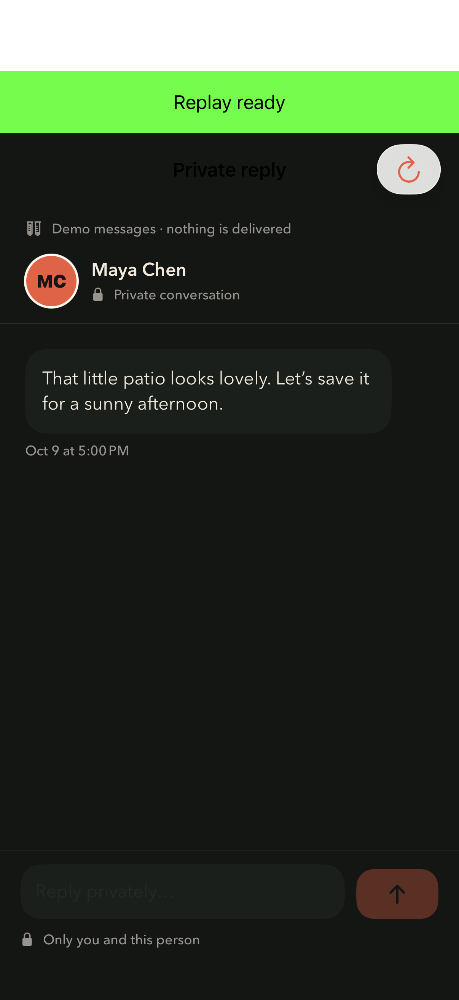
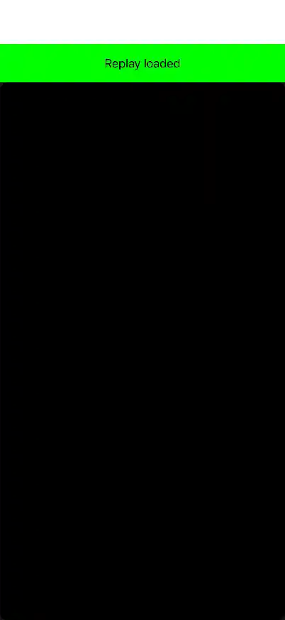

# REC-636 integrated validation

## Replay startup pacing repair

The latest test-only repair keeps requesting a genuine layout at the SDK's existing one-second cadence until the fixture observes its first completed native draw. Previously, merely requesting a layout reserved a ten-second encoding wait, even when no draw had happened. After any completed draw, including a failed draw that the SDK may still encode, the original delivery-progress/ten-second backpressure applies. Four deterministic regressions cover startup, cadence, delivery and timeout behavior. Both original privacy test bodies, 30-second capture gates, SDK settings and every-frame image assertions remain unchanged.

V47 `37170753` remains **Failed: 8,970 Passed / 9 Failed**, zero skipped or expected, across 23 audited bundles and 15 digest-verified archives. All 102 build and 26 runtime warnings remain recorded. The five launch failures involved late system Developer-testing assertion replies after the apps reached foreground. The pan input reached its app window late; the compact picker and onboarding failures lack exact receiving-view/handler observations. These findings do not establish app defects or justify weaker checks.

V48's three original diagnostic cases passed, V49's original onboarding case passed, and V50's original Replay case passed. V48/V50 observation gaps remain separate from those native results. They neither clear V47 nor explain its post-render delay. The startup repair requires its own native checks and fresh complete CI; [PR #736](https://github.com/joelipshutz/wander/pull/736) and [REC-636](https://linear.app/recme/issue/REC-636) record the exact published source and terminal results without a documentation-only validation loop.

The corrected local build passed, followed by **2,865 ordinary unit tests and both original actual-image Replay tests**, with zero failures, skips or expected failures. The first build's initializer-visibility failure is retained separately. The test-source SHA-256 is `80df366480648684a88923b4b2a954206507943465f3a0c02b52f1186be2afa4`; production Swift remains byte-identical to V47. Fresh complete CI remains required and its terminal result belongs to the linked PR/issue.

The review audit verified all eight approved image hashes, both themes on both phone sizes, and source continuity for the completed human freehand journey. These checks need no repeated user drawing. Spoken VoiceOver task completion remains an explicit limitation of spec R15; simulator accessibility assertions do not establish it. Designated signed-in internal accounts remain required for real messaging trials after dormant backend verification. Live stays globally Off.

## Publication checkpoint · exact-commit CI required

Published V36 `22e7c6d9` is fully accounted **Failed: 8,966 Passed / 10 Failed among 8,976 executions**, with zero skips or expected failures across 23 bundles. Accounting `2c4b30c1…` preserves all failures, 26 runtime warnings and 158 overlapping build-warning events. The 15 result/evidence archives are digest-verified; the parent-product archive remains remotely retained without a local binary audit. Its exact ordinary-auth case passed, which establishes neither an actual sign-in nor real-account delivery.

V39 diagnostic source `5bb397b1` passed **4/4** selected executions: Combined Filters on both phones, compact drawer/map and large warm-source switching, with zero official native warnings. Reviews `30d53dd3…` and `754c0812…` bind the source, devices and retained endpoints. Original five-second drawer outcomes, map displacement, Apply/Cancel/Reset and the warm case’s eight-second gate passed. Bounded trace gaps and missing warm-case media remain explicit; these selected results do not reproduce the full CI sequence or clear V36.

Earlier diagnostics retain their identities: V40/V41 stopped before native execution; V42 `378c552a` failed its public-frame gate but could not admit the requested root; V43 `f4b8d8fa` completed a valid fixed-order normal/dormant comparison of the same private method, **1 Passed / 1 Failed**. V43’s observed root association and different CPU observation endpoints identify no particular host task, scheduler/lock/QoS cause or SDK repair. Their original records remain preserved.

The canonical-SDK V44 trial at `9738c599` completed both original Replay methods in separate processes: **1 Passed / 1 Failed**, with zero skips, retries or official native warnings. Private failed the original public-frame prerequisite at line 126: 12 successful native draws, zero delivered frames, and no private presentation. Credentials passed; inspected originals retain public content and mask password/code fields. Accounting `fc135401…` and original-image review `fa954171…` bind source `9cdf8c12…`, canonical SDK, iPhone 17 Pro/iOS 26.5 and exact result/configuration/source guards. Recorded product equality is not an archived binary rehash. Hiding the original host window was insufficient in this execution and does not establish full host quiescence or a cause.

V45 diagnostic `7af0f7f7`, run `38997725087`, is terminal Failed after a successful build. The verified archive independently accounts for one private failure at the public-ready assertion, line 132, with zero official warnings and complete exports; source, result and configuration checks reconciled. The diagnostic reader then stopped at `authored_summary_identity` because of a status-prefix mismatch, so its overall review remains incomplete. Container discovery exceeded its five-second watchdog; owned-process cleanup was confirmed and no sampler launched. No usable profile or cause was obtained.

The reviewed test-only fixture-lifecycle candidate has Replay source `5b3f797e…`. Both methods retain and unwrap the original host window/root, detach and hide that window during the genuine fixture, then restore the exact root and prior flags. SDK behavior, original capture gates and all-frame privacy checks remain unchanged. Focused local validation **Passed 2/2**, with zero failures, skips, expected failures or runtime warnings; 37 build-warning occurrences remain recorded. Independent review `2173251d…` reconciles the exact cases/device, source admission and reports. All 262 production Swift files and 150 build inputs match the V36 reference. Product evidence is a post-run app/unit fingerprint only, without a pre-run product/configuration seal.

Root inspected four distinct original baseline/SDK images: the loaded private surface is opaque with its public marker retained; password/code regions are masked while ordinary content remains readable. One initial failed native draw remains recorded; subsequent frames met the unchanged checks. The existing isolated iPhone 17 Pro/iOS 26.5 review simulator retained its prior state without a reset. This local check exercises compilation, behavior and cleanup; it is not a controlled ordinary-host comparison, a proven cause or clearance of the CI failure. Final exact-commit CI remains a separate acceptance gate recorded in the linked PR/issue.

The authoritative latest disposition is [PR #736 Checks](https://github.com/joelipshutz/wander/pull/736/checks) and [REC-636](https://linear.app/recme/issue/REC-636). Final uninstrumented published-candidate CI and its source/device/product/artifact audit remain required; later results need no documentation-only push. Backend installation, designated real-account trials and release remain separately gated. Live stays globally Off.

## Historical local checkpoint · V36

V36 source manifest `7ec8e1868e6b7a6fc1332d05bc34643bb77a448cee2810ed8b6364677ff584dc` changes no production Swift. The replay test uses distinct public color markers for readiness/freshness while retaining the original 30-second gates, every-frame private-content OCR, selected-frame label checks, SDK capture cadence and credential assertions. No SDK or host-window isolation change is included. The roster has 448 Swift files; fresh parent enumeration is exactly the prior 3,174 methods plus one new marker test, **3,175 total**. All 262 application/extension Swift files match both published `fc52038d` and the recorded V33 source bytes; this is source equivalence, not binary identity or a repeated full suite.

Fresh V36 native checks **Passed 3/3**, with zero failures, skips, expected failures, retries or official warnings: marker probes, private-message replay and credential replay, each in its own process. Independent review `ffae6a45…` and root original-pixel review `0e71c97f…` bind candidate, products, device and originals. Actual SDK pixels show the magenta loaded marker with the private surface blacked out, and readable public content with password/code masked. This local pass does not establish the cause of earlier CI delays. The 12 tooling checks passed. Separate earlier local evidence remains distinct: selected-pin performance and Combined Filters **2/2 Passed** on `a86f59de…`, followed by seeded profile-photo **1/1 Passed** using those same original products; none is relabeled V36 execution.

Published `fc52038d` full CI is closed and **Failed: 8,967 Passed / 6 Failed among 8,973 executions**, zero skipped/expected failures, across 23 bundles and 16 verified artifact archives (`db4eebbf…`). The six failures and 28 runtime warning events remain preserved; later focused passes do not turn that candidate green. The separate canonical-SDK diagnostic CI passed all three selected executions: selected-pin performance and Combined Filters on both large and compact phones. Each native exit was zero, with exact result/device metadata and original captures retained in artifact `12038082662` (SHA `9ae8bda4…`). This diagnostic source includes extra test attachments and is not the final published candidate; its overall run remains Failed because the separate instrumented replay diagnostic failed.

Published V36 `22e7c6d9` CI is now fully accounted as Failed: 8,966 Passed / 10 Failed among 8,976 executions; its named ordinary-auth case passed within that failed run. The detailed disposition is summarized above and preserved in [PR #736 Checks](https://github.com/joelipshutz/wander/pull/736/checks) and [REC-636](https://linear.app/recme/issue/REC-636). Acceptance still requires a later reviewed uninstrumented candidate and fresh exact-head CI; no later source/product identity is assigned to this historical local checkpoint. Backend installation and designated real-account trials remain separate gates. Live remains globally Off.

## Historical test-only successor · V35

V35 source manifest `a3dafb91119a807d2184c3108d2f9d89be6ad7bf0e6152588461967fc7a68963` changes no production Swift implementation. Three UI-test files refine native input and exact outcome readiness; the CI tooling requires the two original replay methods in separate processes while preserving the combined local mode. Original behavior assertions, privacy checks and performance budgets remain. The 447-file Swift roster and all 150 build inputs are unchanged from V34.

The seven-case focused local selection is **7/7 Passed, with zero failures, skips, expected failures, retries or official warnings**, bound by completed receipt `717ec6f3efc89dbb2a0415604556086917aafd533916ebf14bf484132ca1d91a` and independent metadata/original-pixel review `0eb6f4a716ca6366a89d6e82f6b7d96848df51a12a07a48424bfcf0278b38da4`. This is focused successor validation, not a new full-suite pass. V33’s 3,248 local passes retain their original source/product identity (`a91d3321…`); V34’s six focused passes retain their separate `dfdd8574…` identity. Neither is relabeled as V35 execution.

Published predecessor `6b0f1a9e` has known CI failures, which remain Failed. Final published-head CI, exact ordinary-auth execution and checkout/product/artifact acceptance remain required. The authoritative latest disposition is [PR #736 Checks](https://github.com/joelipshutz/wander/pull/736/checks) and [REC-636](https://linear.app/recme/issue/REC-636); later CI results do not require a documentation-only push. Live remains globally Off, with no merge, activation, release or real-account delivery acceptance implied.

## Preserved V33 local validation

**V33’s planned local validation passed 3,248/3,248 executions across 14 phases, with zero failures, skips, expected failures or retries. Final published-head CI acceptance remains a separate gate. Live stays globally Off.**

The source fingerprint binds 447 Swift files and 150 build inputs. Signed Debug and actual Release builds succeeded, including the unchanged Your Map Release-compilation contract. The current parent inventory has 3,174 methods and Clip has 35. Local execution covered 3,173 parent methods and all 35 Clip methods, plus 40 second-phone executions, without duplicate device/case pairs. The sole method intentionally left to independent final CI is `AccountContactDetailsUITests/testNormalAppLaunchReachesLiveAuthentication`. This is a local 3,248 pass, not a local 3,249 pass or a signed-in account trial.

| Current local evidence | Result and scope |
| --- | --- |
| Parent units and replay | All 2,863 unit methods passed, including the unchanged Your Map class 17/17, two CPU cases and combined replay 2/2 in one invocation. Reviewed actual SDK frames retain public controls and mask private messages/password/OTP. |
| Parent UI and compact coverage | All 310 locally selected large-phone UI methods passed. Focused 13/13 passed on each phone, including the six integrated continuity/drawer/filter methods; compact critical and repaired Plus coverage also passed. |
| Clip | Fresh Clip build, exact 35-method inventory and all 35 large-phone plus two compact UI executions passed. |
| Controlled performance | Strict reference 1, CPU 2 and UI performance 3 passed with unchanged assertions and budgets. Calendar presentation was 167 ms against the original <1 s assertion. Selected-pan XCTest metrics recorded CPU 1.091 s and clock 2.443 s; these metrics have no absolute CPU baseline. Per-segment frame-gap/search-p95 numbers were not retained, so none are invented from test durations. |
| Runtime warnings | 22 official events remain: 18 parent and four compact, counting root/action copies once. They comprise 14 state-update, five invalid-frame and three test-helper QoS warnings. Their native cases passed; that does not prove the warnings harmless. Reviewed endpoints establish no specific resulting visual defect. |

The eight review blocks retain distinct evidence limits:

| Block | Current proof / remaining limit |
| --- | --- |
| M1 Profile continuity | Named Live → Profile → Your Map → saved place → Patterns → Live journey and retained filter passed on both phones. |
| M2 Drawer/map | All drawer detents and the fixture’s native map pan passed on both phones. |
| M3 Original content | Exact selected activity, Show in Feed visibility, comments/place routes and return assertions passed. Unavailable production branches are not inferred. |
| M4 Filters | Combined Apply/Cancel/Reset, exact canonical category labels, loaded pin/Feed agreement and pan-without-refilter assertions passed on both phones. |
| M5 Existing Feed | Invite → People → Activity order, embedded three-photo fixture paging 1/3 → 2/3 → Back and actor return passed; production-media paging remains separate. |
| M6 Entry/return | Search, Notifications and Add cancellation/return passed in the named fixture journey. |
| M7 Visual/accessibility | V33 large Dark and compact Light home/Wanna evidence is supplemented by inspected large Light and compact Dark home originals. Both phones’ home appearance endpoints are complete; theme-propagation timing, spoken VoiceOver and hardware behavior are not claimed. |
| M8 Drawing | The unchanged current automated `testDrawingRequiresApplyAndCanBeCleared` and `testAccessibleDrawingControlsRemainReachable` passed on the same V33 app. They use the visible-area alternative. Historical V24 human freehand evidence remains source-bound and unchanged; it is not current continuous-gesture proof. |

V33 opposite-theme review `c9d11c6f…` binds the two additional home stills to source `a91d3321…` and the installed Debug executables. Post-publication Xcode handoff `d78a57ee…` verifies the isolated project, `codex/live-experience-review` in Branch Chooser and **Live Experience Review** scheme, without pressing Run. These complete those V33 review tasks; they do not execute V35 or establish interactive theme-transition behavior.

Adaptive-map cases passed the initial 177-place, selected-dot promotion, close density, first-pinch same-ID separation and final mixed-mode assertions. Reported gesture rectangles fit the measured viewport; current success-retained results lack per-point synthesized touch paths. Historical V31 contacts do not substitute for those missing current payloads.

The finalized eight-image V33 publication pack is 386,432 bytes, including metadata. Root inspected all eight finished images; their bytes remain identical to the approved review images; original captures/bundles remain outside Git. The pack’s local visual approval does not constitute whole-change repository storage or CI acceptance.

Preserved published predecessor `4fe71f0e` CI is Failed: all six workflows/20 checks are terminal; 21 available native bundles account for 8,936 executions, 8,925 Passed/11 Failed/0 skipped. Fifteen of 16 required artifacts were verified; an infrastructure failure prevented UI shard 1’s 37 planned cases. Its actual ordinary-auth node passed, but that older-source pass does not satisfy V33’s final-head gate or explain the historical local auth failure. All historical failures remain intact.

The separate fixed-order replay host-isolation A/B completed **4/4 Passed**: both requested startup modes passed both original methods, with zero failures, skips, retries or official warnings. These repeated diagnostic executions add no unique coverage to the local 3,248. Requested host branches remain source-inferred rather than directly observed. The pair establishes no historical cause and justifies no test/workflow change by itself; all earlier failures remain Failed.

Final published-head CI, its exact ordinary-auth node and provenance are pending at this local checkpoint. The authoritative latest disposition is [PR #736 Checks](https://github.com/joelipshutz/wander/pull/736/checks) and [REC-636](https://linear.app/recme/issue/REC-636). No later CI result is implied by this static local record. Dormant installation, designated two-account behavior, cleanup and operational/privacy gates remain separate. Do not merge, activate, release or message ordinary users.

## Dormant backend checkpoint

The refreshed a0 SQL package passed review across 76 source hashes. Bounded preinstall metadata and full smoke passed and rolled back; the corrected atomic installation rehearsal also rolled back. An independent read confirmed 145 migration versions, no owned REC-636 contracts, and Live globally Off. The original search-path rehearsal failure remains preserved. Neither REC-636 migration is installed.

After native, fresh CI and SQL acceptance, recheck the confirmed target, exact history and prerequisites before the authorized dormant two-migration installation. Independently verify installed metadata, grants, 147-version history and global Off, then run bounded full post-install smoke. An ambiguous write requires read-only reconciliation, never a blind retry. Designated signed-in internal accounts remain required for real delivery, reply/read, revocation and cleanup. See the [backend protocol](../implementation-drafts/README.md).

## Current continuation

Publish the reviewed uninstrumented test-only candidate after final source/storage/tooling admission, then audit fresh exact-commit CI, its ordinary-auth node, all required checks, warning disposition and checkout/source/device/product/artifact evidence. Keep diagnostic markers, samplers and carrier workflows out of that candidate. The focused local pass does not replace final CI or clear historical failures; no cause is inferred from the unusable V45 sample. Preserve accepted unchanged UI observations within their original source scope, and verify the final published branch in Xcode. The authoritative latest disposition remains [PR #736 Checks](https://github.com/joelipshutz/wander/pull/736/checks) and [REC-636](https://linear.app/recme/issue/REC-636); later CI results require no documentation-only push. Dormant installation, internal-account trials and global activation retain their separate gates. Live stays globally Off.

## Historical checkpoint before V33

The following is preserved historical evidence and earlier restart guidance. Its references to “current”, “remaining” or “next” apply to that older checkpoint; use the current continuation above and the linked PR/issue for present work.

October 15, 2026 · Integrated `Wander` app · **V32 category-label 2/2 Passed · V31 targeted 20/20 Passed · final CI required · Live globally Off**

### Current V32 category-label correction

V32 source manifest SHA-256 `7fe7de38b281289b78e32a354b3ef5b55c6e9e70f1ae58cca2be0e1a5d31d4b0` changes only Live’s category title lookup and two exact native label assertions; the other 444 Swift files and all 150 build inputs are unchanged from V31. Canonical category IDs now use their taxonomy group directly, preventing Civic & Faith from being reinterpreted through a provider alias as Work & Education. Selection IDs, filtering, state transitions and analytics are unchanged.

The fresh build exited 0. **Passed 2/2**, one complete Combined Filters case on each phone, zero failures/skips/expected failures and no retries. Fresh product seal `3a94244950f67e0e9ae12bd91da3768ca3f8b6c80c15f30e4c4284423fe8ca8e`; compiled inventory is exactly 3,174 cases. Completed 2026-10-15 23:16:49 UTC; terminal receipt `a96316523e6baf26923587fac4b45a688847eac44f5dcfb909e00b8fb0029015`. Both original draft PNGs were inspected: Work & Education and Civic & Faith are now distinct/readable, with Ryan still selected. The two exact canonical-label assertions and all original Apply/Cancel/Reset outcomes Passed. This narrow check does not relabel V31’s 20/20 result or establish a full-suite/ordinary-auth/CI pass. Final published-candidate disposition, full inventory and exact ordinary-auth case remain recorded in [PR #736 Checks](https://github.com/joelipshutz/wander/pull/736/checks) and REC-636 with actual checkout/artifact provenance.

### Completed targeted validation · V31

V31 source manifest SHA-256 `d24b93460e9d78c1ea13ce5a6bb5d6c2796e5ee04f884ababf9085ed0ebb488f` identifies the reviewed three-file successor: an actual DEBUG fixture Map viewport between chrome and an exact native city-value assertion. The other 443 Swift files and all 150 build inputs are unchanged from V30. Signed build, bindings, compiled 3,174-case inventory and product seal Passed; prepared receipt `29650ed29098f0390b613f44309f63130dc81109cc75d413be4c307e805f95c4` binds artifact seal `cb7027e9ba1bf0c79672eeb3f46b18c43f427c65ef99ed5f0e03a579df84584f`. Preparation executed no test methods.

**Passed 20/20: nine large and eleven compact, zero failures, skips, expected failures or retries. One native warning remains a warning on the Passed compact saved-search case. Completed 2026-10-15 22:51:05 UTC; terminal receipt `d8be9aa71b13b8af9c0368b6beb121d7a2811a8a4fcc1996bd8455df3c1f5245`**. Root inspected both phones’ six original adaptive screenshots and both two-touch native pinch occurrences per phone: all recorded contact points stay inside the actual Map and measured viewport. The unchanged first-pinch separation, 177-place and final mixed dot/category assertions Passed; no numeric after-separation was invented. This is targeted V31 evidence, not a fresh full V31 native-suite pass or a CI conclusion. The final published-candidate CI disposition, full inventory, ordinary-auth named case and checkout/artifact audit belong in [PR #736 Checks](https://github.com/joelipshutz/wander/pull/736/checks) and REC-636; repository docs link those current authorities.

The completed combined-filter case Passed on both phones: Apply gives one Wanna; Cancel preserves the committed values/result; Reset gives two map/Feed results while retaining Only Friends. Seven large originals and seven compact filter originals were inspected. Compact comment originals show rating 4, a sent comment and heart 0→1→0 with activity likes unchanged. Saved Circuit Coffee’s native query/Return and original three-second selected-card/name/no-error assertions Passed on compact; no explicit final Map-card screenshot is available, and no provider-performance claim follows.

Root adaptive review receipts are `06afcf1e…` (large) and `f2590b80…` (compact). Selected-case peer receipts are `be9646b9…` (large filters) and `e0898409…` (compact filters/comment/search). Originals, exact payload/device/case bindings and full receipt hashes remain in shared REC-636 evidence. No ordinary-auth pass follows from these selected fixtures.

The eight-image V28 gallery below retains its own source/products. Backend installation, real-account trials and actual repository storage/payload checks remain separate gates. Historical failures stay preserved and do not invalidate a later independently passing candidate.

### Historical full-native baseline · V28

V28 source manifest `v28-full-native/candidate.json`, SHA-256 `8d6bd5d68a4e702d7f9e791b211f08d6c65ab0f96ccb0494e2279e3f2f300922`, binds 446 Swift files and 150 public build inputs at local head `403407d0c68c8dee37e8c1a06cf468e734adfda1`, integrated main `37b92a6e2daef1da96c266730b9391f1f2253a9f`  / build 184. The manifest identifies the uncommitted tested tree; the commit alone is not candidate identity.

Relative to V26, the reviewed delta is one Live app file and three UI-test files, with 442 other Swift files and all 150 build inputs unchanged. Live adds an opaque appearance-matched backdrop over the actual top safe area without allocating a map/drawer inset or changing camera, drawing coordinates, Profile tools or analytics. The isolated DEBUG embedded-Feed photos, their negative isolation unit and deterministic Plus fixture remain. No historical app byte-equivalence or carried native passes are claimed.

The exact plan requires **3,249 device-case executions**: parent large 3,174 (2,863 units / 311 UI), parent compact 38, Clip large 35 and Clip compact two. Generated Xcode capture defaults, strict `<100 ms` reference, CPU/UI budgets, separate SDK hosts, production replay cadence and every-frame privacy assertions are unchanged. Structured accounting preserves warnings as warnings and every failure as Failed; accounted continuations execute only untouched phases.

| Historical V28 gate | Recorded result / scope |
| --- | --- |
| Signed build, bindings/signatures, compiled inventory and seal | **Passed**. Parent build exit 0; product seal `019f0150ad431211ac80351dc1a4cb525985714f9484b233252471599e34723a`; plan `89595ca74b42d5dd6c2e0883c77c0e207154c7f1d4ed5a7cd1b234a0b8dd059e`; prepare receipt `2acc82c4f72db0f427a7c4c125546a2b7921a55f4cbbabcb1561eb944d19e086` |
| Strict reference and focus | Strict **Passed 1/1**. Each phone's focus **Failed 11 Passed  / 2 Failed**, zero skips/warnings. Strict plus focus totals **23 Passed /4 Failed among 27**. City-return and adaptive native Map zoom failed on both phones; their failures remain Failed |
| Actual status-strip visual gate | **Passed**: home Light/Dark on both phones and Wanna in a verified appearance on each. Root receipt `d334fd8955e7579cb9a4190af6141ba4f0c88937ce71c06528d7c5cd67bfb5ab` binds all six native originals to these products |
| Other completed native phases | **Passed**: Plus 1/1 each phone; regular units 2,859/2,859; CPU 2/2; private SDK 1/1; credential SDK 1/1; UI-performance 3/3. Original thresholds and privacy assertions retained |
| Ordinary auth | **Failed 0/1**. Both launches stayed alive on Clerk recovery UI; the underlying cause remains unresolved. SDK masking and public reachability do not supply a normal-auth pass. The final full parent/App Clip CI (`graphics_only=false`) must provide exact Passed evidence for `WanderUITests/AccountContactDetailsUITests/testNormalAppLaunchReachesLiveAuthentication` in its independent `Parent UI shard 3` under the current inventory, with zero skips/expected failures and matching artifact/device/checkout provenance. That fresh pass is sufficient current auth-entry evidence without proving or relabeling the historical cause; no extra local auth run is required |
| Completed full V28 accounting | **Failed: 3,242 Passed /7 Failed among 3,249**, all 15 phases accounted, zero skips/expected failures. Ended **2026-10-15 21:52:21 UTC**; terminal receipt `54506736485cc62ece88d12e8a9d14cd3ce53c02ea090effb1a2304c4cc85d52`. The final compact critical 24 and Clip 35+2 all Passed. Parent UI remains **290 Passed  / 2 Failed among 292** with all three complete failure entries retained across comment keyboard and submitted Map search; the summary includes two entries. The complete run retains **21 native warning entries** as warnings (17 in this parent UI phase), counted once after root/action reconciliation |
| Gallery | Eight inspected selected-case images, **356,119 bytes including metadata**. Both focus aggregates remain Failed; private SDK Passed 1/1. [Gallery](integrated-captures.md) and [manifest](v28/manifest.json) identify exact source/product/case/device and original/derivative hashes |

### Historical targeted successors · V29–V30

| Generation | Recorded result / scope |
| --- | --- |
| V29 targeted successor | **Failed 9 Passed  / 2 Failed among 11 on large**, zero skips; compact did not run. Source `01bb13229aeab7f23a51a1159160ba0ef95278c79a2b4738533f8fa83b5f69f0`, seal `eb6c00457fd917a6c3b259d2174acd5a10cd740b0e35f097682988995c0b84b4`, terminal `fb1c3873b84b08acc7b6146f89d0dcfc08302d0e3ede5033af59c454c5359db0`. Category row tap did not turn on its contained native Switch; adaptive fixture crashed on unsupported accessibilityFrameBlock getter before gestures. Both remain Failed. Comment hearts and saved Circuit Coffee passed on large; four inspected comment captures show rating 4, heart 0→1→0 and unchanged activity likes. No saved-Map final screenshot or compact result is claimed |
| V30 targeted successor | **Failed 7 Passed  / 2 Failed among 9 on large**, zero skips; compact did not run. Source `801c3396c447107b6089bf293cc79f1fcc4ce6aba64ad55b347bc51f405d3030`, seal `6a68d491bcceec3521e2c7389fbe8a6712df8fbb0cbb97356f13d75fe87259b4`, terminal `85d6a92688e89dc2f93eef99e9fc68b41904173373702e1a899ce9d7c2ef4265`. Adaptive fixture failed its measured AX-frame containment assertion before pinching; changing the native accessibility property did not establish a usable XCTest target. Combined filters reached applied one-Wanna map/Feed agreement and Cancel/reopen, then failed an incorrect retained-city label assertion: native label is City center and value is Los Angeles. Reset did not execute. Fresh UI attachment retention alone changed to `keepAlways`; `screenRecording` and original thresholds/outcomes remained |

The Map failure does not establish external-provider latency or cancellation as its cause: the completed event includes the query and Return, and failure AX has the exact query without the software keyboard or selected card. Production search performance is not claimed fixed. The existing deterministic fixture substitutes only external candidates; the two unchanged competing saved/provider ranking cases already Passed and remain in final full CI. The comment failure has absent keyboard and an original contact intersecting native scrollbar geometry; the actual consuming responder is unproved.

Do not label the complete candidate Passed while its current gates remain open. V31 targeted/native-contact proof is complete; final full CI and the ordinary-auth gate remain required; the V28 gallery does not execute the successor DEBUG fixture. Full native validation is required before committing app implementation. Historical failed candidates remain preserved context and do not invalidate a later independently passing candidate.

### Backend and real-account gates

| Gate | Current proof / remaining requirement |
| --- | --- |
| SQL package and preinstall hosted verification | **Passed and rolled back on unchanged SQL source**: CLI 2.114.0 metadata 14 exact functions/2 private tables/9 keys/660 probes with global Live false; full smoke including App Clip passed in 56.7 s across 14 rollback transactions. Before/after baselines show zero persisted new contract objects, Live rows or reserved profiles across 64 IDs. No installation |
| Bounded SQL execution | Use reviewed exports with 5-second lock/60-second statement bounds immediately after every outer BEGIN and before preview DDL. Require rollback and zero COMMITs; do not recommend raw unbounded generated exports |
| Offline verification tools | Last integrated journal/companion/runner/session receipt: 101/101 (V24). V25 dormant packaging 8/8, parent-regression tooling 4/4 and smoke syntax passed. These do not establish real delivery or native validation. Classifier contracts are separate development-tool checks: warning adapter 12/12 and complete source accounting 11 unique checks |
| Dormant installation and post-install verification | Outstanding. After required native/SQL gates, recheck confirmed target/history and exact ordered pair, then verify installed migration records/ABI/grants/global Off and complete bounded post-install full smoke |
| Real two-account verification | Outstanding. Requires designated internal accounts with signed-in test sessions, reviewed project-bound SQL transport, a private fresh journal and pristine synthetic fixture. Delivery/reply/read, idempotency/concurrency, revocation/block/source changes and exact cleanup remain required; ambiguous writes retain an operator gate |
| Availability | Broader reporting, retention/deletion/export and operational gates remain open. Do not merge, activate, release or message ordinary users |

Hosted receipt `32998e76234906df01f2fad6af4e4963f4a5b16a5afaf5125b0faf62129a99fd`, bounded manifest `08c96fc254b0c6824f1f41740dea80645ac938e073ce81142c945da9a1d8c113` and fresh preinstall baseline `d4a89568418d4bfa14362070d741264fa8ececd9f8cae558dd44c3f146441a0f` bind the existing proof. Neither REC-636 migration is installed. REC-645/REC-646 through main `a0d53b52` are now integrated as the reviewed four-path SQL delta. Refreshed package `af28866b1c3e9010eca70081469913e843780e4e1d63f0550f03e0f97f476d1d` was generated and independently byte/framing-reviewed (`5d58b15d…`): 76 source hashes, exactly two embedded regression-body changes per full export, 14/15 rollback transactions, App Clip once, and immediate 5-second lock/60-second statement bounds. The baseline and two metadata exports remain referenced byte-for-byte; neither REC-636 migration body changed. This generated-package review is offline proof. A fresh read-only hosted catalog observation additionally Passed: 145 migration versions, REC-645/646 and App Clip present, both owned REC-636 versions absent, three exact function source/security/grant contracts and both policy role/RLS postures. Root reviewed both returned policy expressions against the approved semantics. Catalog receipt `eda8c1a6346bc626476209ccf956f0cec38ad22a31637c8dae6f3b0f20e99fd2` claims no behavioral preview or installation. Refreshed bounded metadata/full smoke and before/after baselines remain separate; reconfirm history before deployment. Native/workflow inputs are unchanged by the SQL delta; bind the final Git/SQL tree separately. Keep global `unified_live_v1` Off; both messaging participants need explicit server account approvals. See [implementation drafts](../implementation-drafts/README.md).

### Captures and hands-on scope

The [eight-image app gallery](integrated-captures.md) contains both-size home, compact Wanna, retained Profile Patterns, compact embedded photo 1/3→2/3→Back and the actual offline SDK masking frame. The 10-file pack with corrected README is **356,119 bytes** (333,882 image  / 22,237 metadata), below the 385,000-byte local budget. Manifest `b408112d9d6768c4d406863870f8bc27b740f237527fb04957b6dcff1c769757` binds unchanged image/provenance bytes. Original copy plan `71587e85057b103d1fa4bde5983beb3e7afaf751bd8a58ef4b31387f051d61de` records the initial 356,092-byte pack; the current total includes only a README wording correction. The optional V26 before image is omitted; no original or historical evidence was removed. Every selected native case Passed, while both focus aggregates remain Failed. Root's separate six-original status-strip review passed. These are V28 pixels, not execution proof for the proposed later fixture candidate.

Historical V24 manual evidence remains separate: 94,405 bytes including its corrected README and unchanged provenance and two irregular-preview images; six separately inspected original stills cover preview/committed/invalid endpoints. Apply, pan, tab/detail return, Cancel retention and Clear are human-reported. Recording decode failed before any frame, so no independent continuous-contact/video-motion, current freehand, spoken VoiceOver or hardware claim follows. Stills and fixtures do not establish real delivery, production paging/volume, device-location centering or offline server revalidation.

Enforce actual repository limits of 1 MiB/file and 5 MiB/change against the integrated base/final tree. The gallery's local budget pass is not the repository storage-check result. Raw bundles, recordings, traces and original PNGs remain in shared issue evidence outside Git.

### Remaining sequence

1. Preserve the completed V28 full accounting and its seven Failed executions; do not restart unchanged phases. Use the independent final full-CI named auth case as the current auth-entry gate; do not require historical-cause proof before a valid fresh test or treat SDK/public reachability as sign-in validation.
2. Preserve V31’s completed 20/20 targeted result and both native-contact reviews with their exact source/product identity. Earlier large-only passes and failed generations keep their original scope; targeted closure does not relabel the historical full V28 suite or replace final full CI.
3. Finalize the review/gallery/storage/payload, publish the exact candidate and finish fresh checkout/tree-bound CI. Record latest CI conclusions in PR/Linear without an unnecessary docs-only push.
4. Verify the refreshed package against the current hosted prerequisite/history state and run the reviewed bounded preview sequence, then finish authorized dormant installation, post-install verification and designated signed-in internal-account trials. Keep Live globally Off. Review readiness and backend completion are separate conclusions.

### Resume from receipts

Read `v28-last-three-continuation/completed-status.json` and its immutable phase receipts first. The original accounting stops and all seven failures remain preserved. All 3,249 V28 executions are complete; do not restart prepare/focus or repeat unchanged phases. V29/V30 are stopped large-only targeted generations. V31 has completed 20/20 targeted cases; use its immutable terminal/phase receipts and native-contact reviews, not an unchanged rerun or old dispatch commands. Final published-candidate CI conclusions, exact checkout/artifact audit and run links belong in [PR #736 Checks](https://github.com/joelipshutz/wander/pull/736/checks) and the linked REC-636 record; the repository report links those authorities rather than freezing a queued/running CI conclusion.

```sh
# Only a completed bundle named by its receipt:
xcrun xcresulttool get test-results summary --path "$REC636_COMPLETED_RESULT_BUNDLE"

# Offline tools do not execute real trials:
node --test scripts/rec636-dormant-metadata.test.mjs \
  scripts/rec636-real-client-verification.test.mjs \
  scripts/rec636-mutation-journal.test.mjs \
  scripts/rec636-cleanup-companion.test.mjs \
  scripts/rec636-real-client-write-runner.test.mjs \
  scripts/rec636-real-client-session.test.mjs

# After reviewed dormant installation on the confirmed target:
supabase migration list --linked
supabase db query --linked --project-ref "$REC636_CONFIRMED_PROJECT_REF" \
  --file "$REC636_BOUNDED_POSTINSTALL_SMOKE_SQL"
```

### Historical candidate records

These records belong to their named sources/products. They do not validate V28.

#### V26 stopped focus validation and V27 equivalence stop

V26 manifest `d924dddfdfe0008160be130ae66f73e8f1e30e44e7984a9b0074cea35349d27e` built/sealed successfully. Strict reference passed 1/1 at 69/71/62 ms against the unchanged `<100 ms` limit. Large focus was **Failed 11/13**; compact focus **Failed 9/13**, with zero skips/expected failures. Together, only **27 planned executions completed: 21 Passed /six Failed**. The remaining 3,222 did not execute; this is not a full-suite result.

| V26 failed method | Large | Compact | Concrete evidence |
| --- | --- | --- | --- |
| Combined filters | Failed | Failed | Native city option exists, but the helper incorrectly requires the parent list itself to be hittable |
| Pin → Show in Feed | Failed | Failed | Selected-card reveal failed before Show in Feed; native drag corridor/geometry evidence retained |
| Sender large-text/dark controls | Passed | Failed | Three native reveal drags entered Explore types before silent activation/save; original editor-route guard failed |
| Adaptive Your Map | Passed | Failed | Native two-finger target resolved to an unoccluded 7×11 region and could not synthesize its gesture |

The embedded Feed photo method passed on both phones, with actual decoded first/second images and Live return inspected. That closes its V26 fixture branch only. The compact accounting stop `failed_case_without_source_assertion` remains preserved separately from the actual native 9/13 result; no failure was hidden or relabeled.

V27 built the three-file UI repair once (build exit 0) but stopped **before all tests** on `app_unit_extension_clip_config_or_other_non_ui_bytes_changed`. The complete 733-path inventory had 34 changed files, including 27 outside the admitted UI delta; literal product equality failed. No composition or native test execution occurred. Its stopped status `7994c9d817cd1421d8c8350b0e008819bb7b750d4900aef5fa548a982c996f8d` and metadata/binary differences remain. Unchanged source is not proof of identical products, and no causal nondeterminism exemption is used. V28 instead requires a new app build and all 3,249 executions fresh.

#### V25 baseline and capture-format experiment

Baseline manifest `510bc948d50cd20c8414fdc0a1482900303ec97d70d7235d0fcf12eb18e828ce` completed **Failed: 3,242/3,247 passed**, zero skips/expected failures: all 2,862 units passed; large parent UI 307/311; compact parent 36/37; Clip large 35/35 and compact two/two. The five failed device-case executions are Combined filters on both sizes, large Pin→original Feed comments, strict reference frame budget (103 ms) and voluntary Plus introduction. The native picker, fixed-distance scroll and live-nearby fixture dependencies have concrete test-only repairs; V26 evaluated those attempts and retained its own failures below; none validates V28. Baseline failed bundles and both classification stops are preserved. Nonfatal runtime warnings remain warnings on their actual Passed cases (16 large and four compact entries); they are not extra failed tests.

Both baseline signed builds succeeded before a broad Clip verifier lookup failed. Byte-verified product clones and exact xctestrun bindings/signatures recovered those products without rebuilding. This historical recovery does not establish V26 parent binary equality.

The completed single ordered A/B pair used the same app/unit/UI/framework/resource bytes, changing only UI capture format and keeping retention. Screenshots A **Failed** with 110/145/162 ms gaps; screenRecording B **Passed** with 57/58/77 ms. Both retained strict <100 ms. B had fewer sampled frames and more flagged hitches, so its lower maximum gap is not general smoothness proof. Host cadence and offending callback cost were not measured; capture or app-renderer causation is unproven. All A assertions remain Failed. V26 explicitly preserves the fresh generated Xcode capture default; it does not choose a passing arm or change thresholds. A/B is diagnostic, not V26 signoff.

#### V24 signed full suite and later checks

Original V24 full: **Failed, 3,146/3,148 passed** (units 2,845/2,845; UI 301/303; zero skips/expected failures). Sender dark/large controls and adaptive Your Map failed. Isolated ordinary auth/private SDK/credential SDK each passed 1/1; original compact critical checks passed 30/30. Later focused Sender checks passed 14/14 on each size. Other V24 diagnostics retain their own Failed/Passed receipts and UI-harness identities; none relabels the original full result or supplies a V25 pass.

### Recovery verification — October 14 (historical)

Published source was recovered after temporary local storage became unavailable. Original local V16/V17 bundles, logs and unpublished tooling are currently unavailable; their prior counts remain historical observations. Three current-head CI evidence archives were recovered with matching GitHub SHA-256 digests. They are separate from the missing local full-suite result.

The V18/V20 recovery source is identical across all 424 tracked Swift files, including the standalone prototype. Only two native test files differ from published head `9f31d33a5`: bounded exact-value readiness for the typed draft, and replay callback/decode diagnostics plus inspection of every unseen frame. App source, replay cadence, performance limits and all privacy assertions are unchanged.

| Recovery check | Result and scope |
|---|---|
| V18 isolated private replay | 1/1 passed, zero skips. Fresh loaded control and all-frame forbidden-text checks passed across five frames; one native draw was incomplete. The actual SDK image masks private content. |
| V18 isolated credential replay | 1/1 passed in its own process. |
| V18 large inbox/thread switcher | 2/2 passed on iPhone 17 Pro. |
| V20 compact inbox/thread switcher | 2/2 passed on iPhone 13 mini. Draft readiness, visible stable cover, forbidden-text scan and restored draft checks remain. |
| V20 full units plus remaining V16 failure rechecks | 2,819/2,819 passed, zero skips: all 2,808 included units and eleven original failed UI cases. Together with the large thread check, every original V16 failing case has a later focused pass. This does not relabel the original full run. |
| Dormant metadata recovery | Reviewed metadata preview passed fourteen function ABI/security checks, two private tables, nine keys and 660 type/range probes. Global Live stayed Off; baseline before/after found no new objects, Live flag rows or any of 64 reserved profiles. No migration is installed. |

V18 compact privacy failed because the local iPhone SE bottom swipe opened Control Center. A V19 Home-button attempt reached the Home screen and failed the same stable-cover gate; that test change was removed. These failed bundles remain in durable evidence. V20 uses the supported Home-indicator gesture on iPhone 13 mini; the passing capture does not establish an SE app-switcher result.

An independent review found that the metadata evaluator needed a restricted catalog search path and rejection of unreviewed executable dependencies before dynamic evaluation. That guard is now in the durable verifier; its hardened rollback preview passes. Definition fingerprints from the reviewed preview supplement the ABI/grant checks before installation.

### V21 integration (historical)

Candidate `12eaf3f1d45b52c68470a58fd2d828fb0b9152aa` integrates main `4e2b1222189fab6d2a9757cfdf808a18933e3f7e`, including REC-641 Feed ratings/attached-save photos and REC-642 notification session readiness. The frozen record covers 425 tracked Swift files and 22 build/configuration inputs. The V18/V20 results above did not validate that candidate.

Build-for-testing passed. The finalized large full suite passed **3,115/3,115**, including **2,828 units** and the unchanged performance budgets. Separate private and credential SDK replays each passed **1/1**. Compact Live/Feed/privacy completed **Failed, 21/23**, with the private-demo and Settings guide cases failing. No result is still running or queued. These historical results do not validate V25.

The replay merge retains every private-frame OCR and loaded-control assertion, callback/decode diagnostics and production one-second cadence. Credential replay adopts upstream's independently rendered native baseline before SDK activation, plain-view layout pulse, separate activation/capture deadlines and original pixel checks. Typeahead preserves selection/action/deletion assertions and adds exact-value readiness. Workflow coverage is the union of upstream and Live/privacy cases.

Upstream workflows exclude two hosted wall-clock benchmarks while keeping their deterministic contracts. Their original local limits remain required and passed within V21's unit suite. A future green hosted workflow does not itself prove those performance budgets.

The subsequently published `12eee34d18556f01f58d2809035c1db24061eba7` has preserved red [Feed CI](https://github.com/joelipshutz/wander/actions/runs/38623416809) and [Privacy CI](https://github.com/joelipshutz/wander/actions/runs/38623416814). They remain Failed, not queued current checks. At that checkpoint, the durable mutation journal, scoped cleanup companion and bounded runner passed **91/91 offline checks**, with zero skips. Independent review confirms that ambiguous transport remains blocked even if journal annotation fails, concurrent branches drain before cleanup, and repeated cleanup verifies original logical row identities. The companion metadata preview passed all 24 exact function/trigger contracts and client-grant checks in a single rolled-back transaction; before/after baselines contain zero new contract objects, Live flag rows or reserved profiles. Account-specific rollback trials and real delivery remain unexecuted. The existing preflight remains read-only, and the new runner requires a verified programmatic adapter, designated internal accounts and signed-in sessions. No new migration is installed, and Live remains globally Off.

### Historical V15/V16 evidence

- V15 changes only three test files after V14: replay layout/OCR scheduling, switcher screenshot/OCR timing, and separately asserted mention deletion steps. App source, performance budgets and all 21 tracked build inputs remain unchanged. The 403-source/21-input manifests match after the V16 focused runs.
- [V15 Privacy CI](https://github.com/joelipshutz/wander/actions/runs/38478621783) passed 2,813 unit/large-UI tests and four compact tests, zero skips. Inbox/thread switcher checks passed on both sizes. Private SDK replay and credential replay each passed in separate processes.
- [V15 Feed CI](https://github.com/joelipshutz/wander/actions/runs/38478621773) failed two unit checks: list projection 138.927 ms against the unchanged 120 ms budget, and a two-second share-loader callback wait. The same share test passed in Privacy at the same head. Feed compact scrolling, generic build and both isolated replay scenarios passed. Preserve this failed workflow result.
- Both V15 private SDK replay runs observed the fresh **Replay loaded** control and checked all collected frames for forbidden text: five frames in Privacy, seven in Feed. Zero failed native draws were reported. These close the V14 stale-frame observation; they do not alter the earlier failed evidence.
- V16 same-host diagnostics passed all five checks across baseline, candidate and isolated share-loader runs. Search p95 was 22.103 ms on frozen main and 24.322 ms on the candidate, both under 50 ms. Both high-data tests passed their unchanged 120 ms list/500 ms cold assertions. Logged list stage subtotals were 62.959 ms and 55.788 ms, respectively; these exclude final logging/return overhead and are not the exact asserted total. The isolated share loader passed in 0.209 seconds.
- V16 full native historically ended with exit 65. Logs recorded all 2,808 included unit passes plus 272 UI passes and twelve UI failures, with one automatic runner restart. Its original bundle is now unavailable, so aggregate/crash accounting cannot be newly confirmed. Every original failed case later passed in focused V18/V20 recovery checks; those results do not relabel the original full run.
- V16 evidence: `v16-benchmark-baseline`, `v16-benchmark-candidate` and `v16-share-loader-candidate`, each with `.log` and `.xcresult` in the shared evidence directory. This single iPhone 17 Pro/iOS 26.5 comparison does not demonstrate a budget regression; it does not establish the documented iPhone 16 Plus/iOS 18.6 reference-device signoff. That runtime is unavailable locally.
- The ordered [SQL migrations](../implementation-drafts/README.md) are packaged with executable bodies matching the reviewed drafts. Both targeted rollback-only previews passed. Live initially exposed fixture contamination from automatic signup follows; isolating only the exact synthetic accounts fixed both original regression sections without changing production SQL or assertions. Independent review confirms that scope. Rollback verification found no new tables, RPCs, flag rows or fixture profiles. The first broader smoke preview failed an existing notification-copy assertion; the unchanged notification test also failed without Live. [REC-638 / PR #741](https://github.com/joelipshutz/wander/pull/741) restores already-deployed migration source and corrects three expected strings without changing security assertions. Its full existing-schema hosted smoke passes. The Live candidate includes the correction, and the complete linked Live preview also passes with both new migrations. Preview mode omits the paid-import ledger suite by the existing runner rule; that suite was included in the passing existing-schema run and remains required post-install. No new messaging tables or public inbox/Live RPCs persisted. Neither new migration is installed.
- The additional rolled-back metadata preview passed all 14 exact function definition/security/ABI checks, two private-table RLS/grant checks, nine registered flag keys and 660 key/type/range cases. The global Live flag remained Boolean Off inside the preview. Baseline checks before and after confirm no new contract objects, Live flag rows or any of the 64 reserved fixture profiles persist. This is preview evidence; post-install verification and real-client behavior remain required.
- Xcode handoff is verified: the isolated worktree project is open, Branch Chooser shows `codex/live-experience-review`, and the selected scheme is **Live Experience Review**. No app was launched by this handoff.
- V14 full native was interrupted after all 2,808 units passed, during UI timeouts, and result finalization was incomplete. V14 Feed and Privacy CI failed. V15 compilation passed; later candidate completion belongs to its own receipts in PR #736 and REC-636.

### Historical candidate checks

- Branch: `codex/live-experience-review`; integration base `d9f827353648bab91a17187721b5ea41e65e1a42`.
- Worktree: `/private/tmp/wander-live-review`; raw evidence: `/private/tmp/rec636-evidence/`.
- V12 source: **392 Swift files and six build inputs** match across both runs, recorded in `v12-source-hashes.json` and `v12-build-inputs.json`. Later source changes require a new candidate record.
- V13 source is frozen in `v13-source-hashes.json` and `v13-build-inputs.json`: **403 native Swift files and 21 tracked build inputs**. All hashes and the native source path set were verified unchanged after the full run. This expands the manifest to existing extension/shared source and tracked configurations; it does not imply new source files. XcodeGen produced no project or generated-file diff before the freeze.
- V14 retains the same **403 native source files and 21 tracked build inputs**, recorded in `v14-source-hashes.json` and `v14-build-inputs.json`. Main contributes only build 181 metadata and the people-picker spacing test assertions. XcodeGen produces no further diff; independent merge review confirms the Live tests and imported assertions are preserved.
- Xcode 26.6 / iOS 26.5; iPhone 17 Pro and iPhone SE (3rd generation).

| Check | Result | Evidence and scope |
|---|---|---|
| V12 large | **2,818 passed: 2,807 units + 11 Live UI** | `live-v12-final-large.xcresult`; units exclude isolated `ReplayMaskingTests`. Includes final query/store/lease, messaging, recovery and first-entry search-focus source. |
| V12 compact | **11/11 passed; no failures or skips** | `live-v12-final-compact.xcresult`; all 11 Live UI journeys using the same built app as large. |
| Original Feed return regressions | **2/2 passed** | `live-v11-search-return.xcresult`; original automatic-focus back-button and swipe-back paths pass after restricting Discover autofocus to a new search entry. Temporary manual-focus diagnostic removed from V12. |
| Credential replay | **Passed alone in a fresh process** | `live-v8-credential-isolated.xcresult`; does not establish private-message replay freshness. |
| Analytics/tooling | **Contract check and 12 dashboard tests passed** | No subsequent analytics event/property changes. Demo sends suppress analytics; message-success properties are aggregate-only. |
| SQL preparation | **Smoke-runner syntax and both rollback-preview generation checks rerun successfully; static review completed** | At this historical check both drafts were **unpackaged, undeployed and unexecuted**; current packaging is recorded above. Generating rollback SQL is not database execution. |
| V13 private replay | **Passed on large and compact** | `replay-v13-private-opaque-large.xcresult` and `replay-v13-private-opaque-compact.xcresult`; exact post-load SDK control plus forbidden-text checks across every collected frame. |
| V13 credential replay | **Passed in its own process on compact** | `replay-v13-credential-bounded-cadence.xcresult`; credential assertions retained. |
| V13 switcher privacy | **Inbox and thread focused checks passed on large** | `ui-v13-inbox-isolated.xcresult` and the thread case in `ui-v13-large-map-privacy-baseline.xcresult`; active fictional content, centered inactive cover and return behavior checked. See the startup-tap limitation below. |
| V13 compact Feed | **Passed with fresh accessibility count queries** | `ui-v13-feed-fresh-query.xcresult`; original counts, pagination/end assertions and 15-second wait retained. No Feed implementation change. Hosted CI confirmation remains pending. |
| Final V13 compact focus | **38/38 passed** | `ui-v13-final-focused-compact.xcresult`; 36 shared-input contracts, expanded Map regression and Feed paging. |
| Final V13 large focus | **39/39 passed** | `ui-v13-final-focused-large.xcresult`; the same 36 shared-input contracts, expanded Map regression and both private inbox/thread switcher checks. |
| V13 full native | **3,082/3,092 passed; ten UI failures, no skips** | `live-v13-full-native.xcresult`; all 2,808 units and 274/284 UI passed. Isolated replay is excluded. See the late-run failures below. |
| V13 late-failure rechecks | **All ten original failures passed unchanged** | `ui-v13-awake-failure-recheck.xcresult` passed nine cases; its appearance case exceeded an insufficient 300-second command limit. `ui-v13-awake-appearance-recheck.xcresult` then passed that case in 431.322 seconds with a 600-second allowance. No app/test source or assertion changes. |

Native units cover query/account/page fencing, accepted filter dimensions, monotonic per-row receipts before media work, lease expiry and filtered-empty-page continuation. Messaging tests use synthetic responses for retry identity, refresh/context loss, account/cancellation fences, one 401 refresh and disabled HTTP cache/cookies. They do not establish server authorization or real delivery.

The **Live Experience Review** scheme uses the production Live shell and existing Feed/Profile with isolated authenticated fixtures. Demo replies acknowledge **Simulated** and deliver nothing. Invitation rehearsal uses a detached Wanna, without sending an invitation or writing to the shared store; the dated received-invitation fixture exercises the existing recipient route. The [V12 gallery](integrated-captures.md) presents fourteen selected large/compact captures with candidate provenance. Original captures remain outside Git; the selected images do not prove hosted delivery or replay freshness.

### Focused V13 privacy evidence

The replay fixture now uses the production configuration's one-second capture cadence. Its former 0.1-second override could queue screenshots faster than the SDK's serial image encoder delivered them. The test waits for exact public controls before and after loading the private view, inspects only newly delivered images while waiting, then checks every collected image for forbidden private text. Each replay scenario runs in a separate process in CI. Events are dropped before upload and the fixture transport is offline.

The native fixture independently renders readable fictional participant/message content. The actual SDK output then shows the new public **Replay loaded** control with the private SwiftUI surface masked. The final large run collected eight SDK images and reported 23 successful native draws with zero incomplete draws. Compact collected ten images and reported nine successful and two incomplete native draws; the SDK does not attach draw-success metadata to individual images. Compact's freshness/privacy checks still passed, but it is not proof that every native capture was complete. No production masking behavior was changed to obtain these results.

| Large native fixture | Large actual SDK frame | Compact actual SDK frame |
|---|---|---|
|  |  |  |

These are original PNGs copied without visual edits from the two final opaque-fixture result bundles. Frozen replay test SHA-256: `feecbe2bab22f8c2fd22b7c5b996ccf41b1c5f06a58c7f1c8c3aa3ac455acaad`.

The switcher test now waits for the privacy-cover label to be centered and stable before accepting the card framing; full-screen forbidden-content assertions remain. Both final large captures visibly show the centered Astir card with the opaque cover. Full-resolution recordings and switcher PNGs stay with the result bundles outside Git. In the first V13 combined run, the inbox case failed earlier: a highlighted Messages tap did not open the sheet. The exact isolated case and both switcher cases in the full run subsequently passed without a retry or navigation delay. Source review did not establish a startup reset cause; this history is not a claimed navigation fix.

The messaging draft also rechecks context after both the sender-lock wait and a possible reciprocal-pair insert wait. Rollback regressions now cover the 50-conversation daily boundary, existing-thread reuse, another sender's quota, window expiry and revoked-context restoration. Swift/SQL RPC argument, response and cursor contracts were independently reviewed without a blocking mismatch. These remain preparation results, not database execution or real-client authentication evidence.

### Final V13 Map accessibility repair

The Map host exported a directly represented text editor even when its native hidden, interaction and accessibility flags excluded it. A plain represented container now retains the same native editor and controls its accessibility children. Native/hosted tests preserve text, mentions, selection, composition, sizing and parent-level hit testing through hide/show. The hidden search icon and Clear action are omitted while the editor remains mounted.

The expanded nonempty-query check independently found that the search row's inherited interaction shape made Clear claim the entire capsule in accessibility. Removing that row-level shape and giving Clear its own 44-point plain target restores distinct, nonoverlapping editor/button bounds. The original glass surface is unchanged. Testing the original represented editor with this shape fix still failed hidden accessibility, establishing that the container is also required.

Both final phone runs verify no hidden editor, placeholder, icon, Clear, Add or Cancel; after dismissal, exactly one hittable editor retains `coffee`, Clear has separate bounds, and a physical tap opens the keyboard. Original navigation/filter assertions remain. Failed intermediate experiments are not retained in production code.

### Full-run failure reconciliation

V13 completed all scheduled tests, but its ten late UI failures keep that full result red. One appearance test, one Profile alignment test, one Profile header test, all three Profile responsiveness tests, two Share Card tests and two Your Map tests failed. Several nominally short actions took hundreds of seconds, including actions in passing neighboring tests. The adaptive Your Map test additionally reused a pin whose unobstructed gesture frame shrank after zoom. All ten passed unchanged on the same built app in the separate rechecks above. No production or test fix is claimed for these ten cases.

The first recheck's 300-second command-level limit was shorter than the appearance test's earlier passing V6 baseline of 362.647 seconds. Its separate 600-second recheck passed without changing the original five-second appearance assertions. Keep that harness-limit failure distinct from the original full-run failures. This historical recheck did not supply a passing full-run result for that candidate.

V6 full completed **3,059/3,070 passed**: all **2,788 units** and **271/282 UI**. The table accounts for all eleven failures. All eleven have subsequent focused passing rechecks and also passed within V13's full run. This is not a passing full-suite result on V12 or V13.

| V6 failing test | Later result |
|---|---|
| `AccountContactDetailsUITests/testNormalAppLaunchReachesLiveAuthentication` | **Closed — V7 signed pass.** |
| `ImportFormRefinementUITests/testShareExtensionAutomaticallyCapturesExactlyOnce` | **Closed — V7 signed pass.** |
| `LiveMigrationAndPrivacyUITests/testDeferredCalendarRecoverySurvivesRelaunchAndExplicitOffRollback` | **Closed — V7 and V9 pass.** |
| `LiveMigrationAndPrivacyUITests/testPartialGuideAcknowledgementsPersistAcrossRelaunchAndRollback` | **Closed — V7 and V9 pass.** |
| `MapFilterInteractionUITests/testMoreFiltersHidesMapDockAndBottomNavigationDismissesWithoutResetting` | **Closed — final V13 passes on both sizes.** Hidden AX absence, original navigation/filter behavior, retained nonempty query, distinct Clear bounds and restored physical input are checked. |
| `MapPlaceCardUITests/testREC386ShowsMemberPhotoThenDeletesDisposableCheckIn` | **Closed — V7 signed pass.** |
| `OnboardingUITests/testFeedInlineSearchCoversEntryEmptyResultsNavigationAndBack` | **Closed — V11 original swipe-back pass**, alongside the original automatic-focus back-button test. |
| `OnboardingUITests/testLoggedOutCarouselAutoAdvancesAndKeepsActionsVisible` | **Closed — V9 pass** with fresh page-value queries. |
| `OnboardingUITests/testMapWannaAndSaveRespondToSinglePhysicalTap` | **Closed — V7 pass.** |
| `OnboardingUITests/testReturningUserColdStartAndOrdinaryForegroundOpenFeed` | **Closed — V9 pass** with deterministic stale-checkpoint coverage; the new explicit-Profile destination check also passes. |
| `PersonTypeaheadUITests/testCheckInAndWannaNotesUseTheSamePicker` | **Closed — V7 and V9 pass.** All seven people-picker checks passed V7. |

Recheck bundles: `live-v7-signed-recheck.xcresult` (**2,828/2,834 passed**), `live-v9-focused.xcresult` (**49/53 passed**) and `live-v11-search-return.xcresult` (**2/2 passed**). V7's stale unit source assertion was corrected; V12 all-unit verification passes. V9 passed all 41 walkthrough units, three D9 recovery checks, thread switcher privacy, carousel, both stale-checkpoint destinations and notes. Its four failures were Map accessibility, inbox switcher capture, private-message replay and Feed back-button return; V11 closes the Feed failure.
