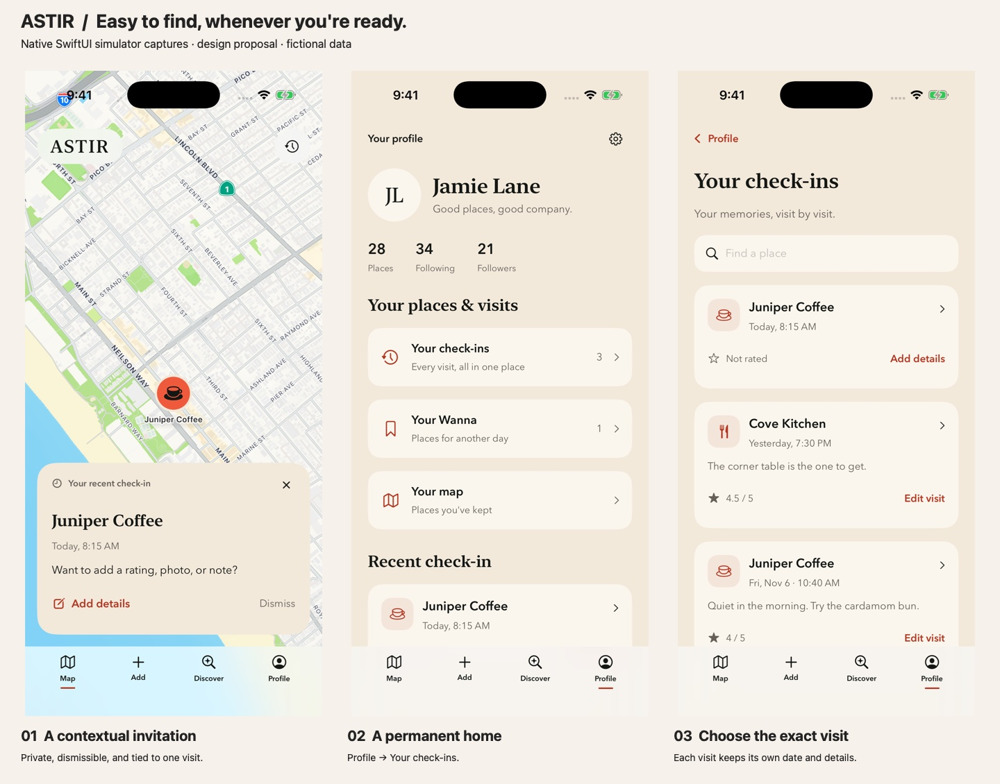
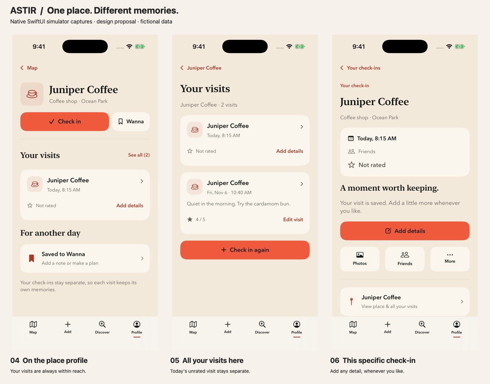
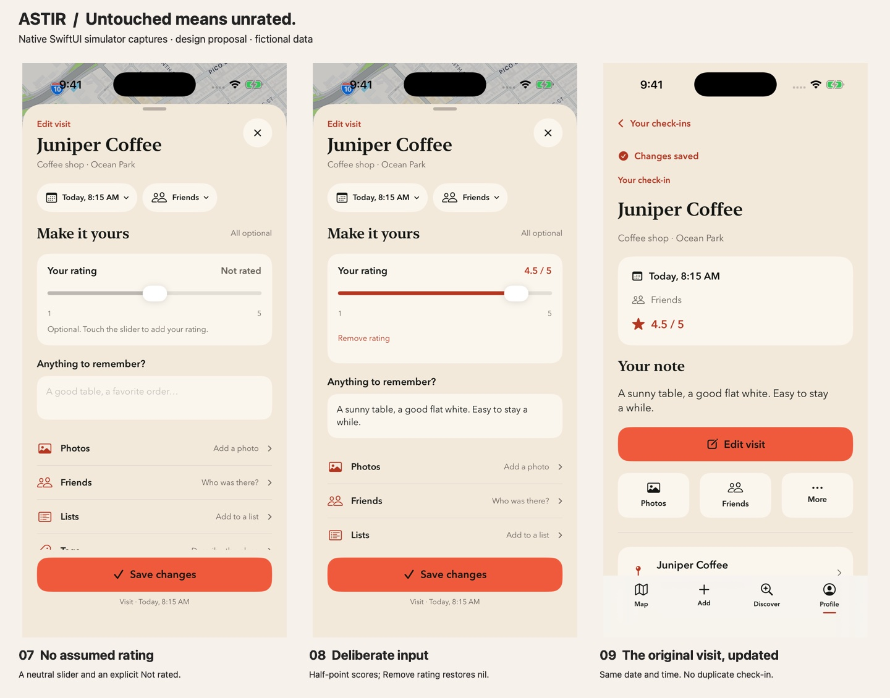
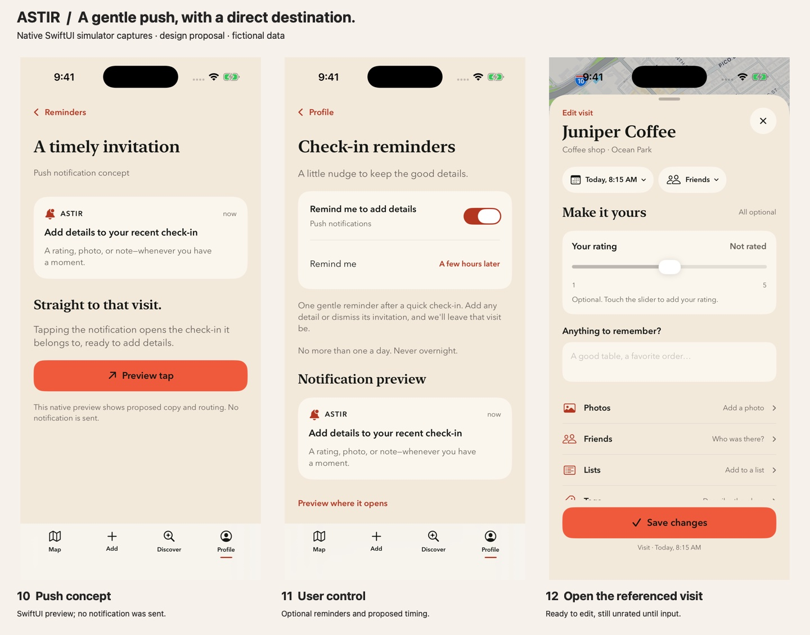
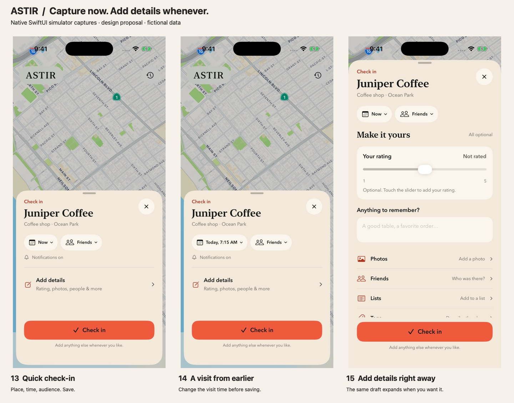
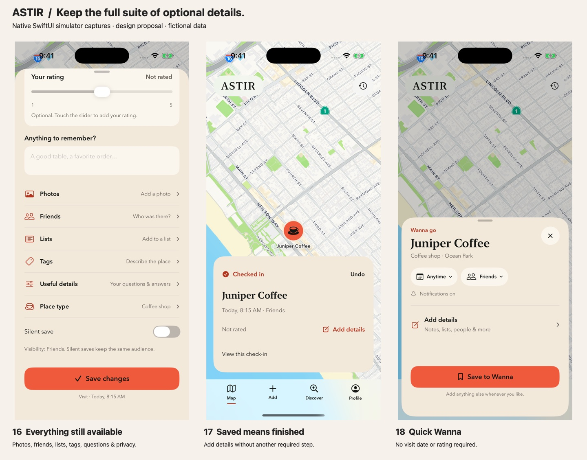
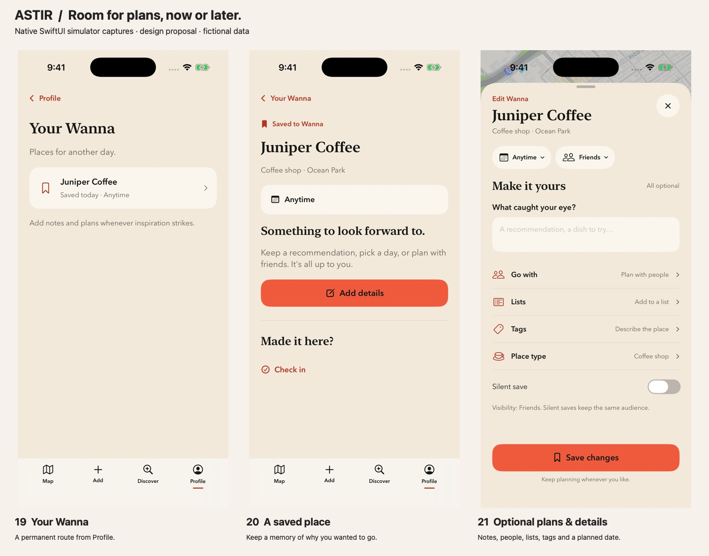
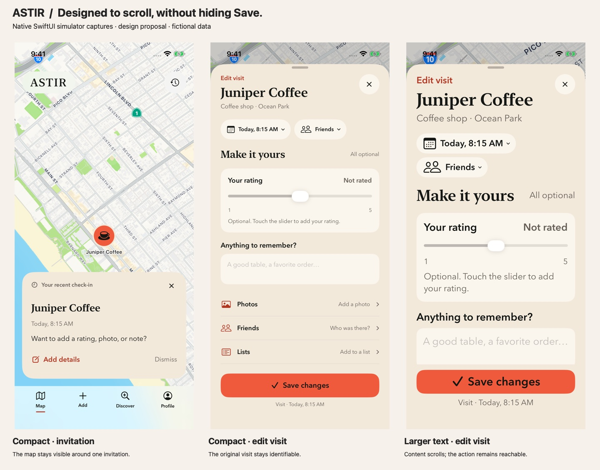
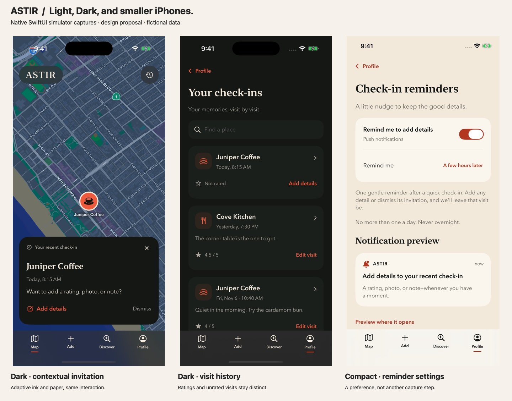

# Quick Check-in and Wanna capture

Status: proposal for review, not approved production behavior.
Tracking: [REC-680](https://linear.app/recme/issue/REC-680/explore-quick-check-in-and-wanna-capture-with-optional-details-later).
Source baseline: `743e990b05`. Native harness: `preview/rec-680/`.

## Native mockups

The current review set covers the complete capture → return → exact-visit edit
journey. These are native SwiftUI simulator captures of an isolated prototype,
with fictional data. They are not screenshots of changed production behavior.



















The notification concept is a SwiftUI preview, explicitly labeled in the
harness. It is not a delivered OS notification or an APNs test. No reminders
are scheduled. Settings demonstrate a possible preference, not a new default.

## Recommendation

Make a visit easy to record and easy to enrich. A check-in with no rating,
photo, note, friends, tags, answers or lists is a complete, valid check-in.
It is not a draft or an overdue task. Optional detail is valuable but never
the price of admission.

Use one compact capture sheet, shared with the existing detailed editor:

1. Place identity, already resolved by search, nearby selection or place profile.
2. Editable visit time and visible audience/notification controls.
3. Primary **Check in** or **Save to Wanna**.
4. Secondary **Add details**, expanding to the complete editor in place.

After saving, return to the original map/place context with a modest success
message and **Add details** / **Undo**. Do not insert another required screen.
The exact saved visit is also editable from its history/activity card and
place profile. No completion percentage or missing-rating warning. Pair a
private contextual invitation with an optional, bounded push reminder; details
remain optional and the saved visit remains complete.

Target: one confirmation tap and roughly 3–5 seconds after the intended place
has been resolved. This is a usability target, not a measured result. Place
search, permissions, authentication and poor connectivity can take longer.

## Scenario matrix

| Situation | Recommended path | What persists |
|---|---|---|
| At a place, no time for details | Add → nearby place or existing place card → Check in | Place + new visit + time + current audience; rating null |
| At a place, wants details now | Same sheet → Add details → fill any subset → Check in | One visit with only deliberately entered details |
| Logging a visit an hour later | Search/select place → time control → An hour ago or specific date/time → Check in | Actual visit time separate from record creation time |
| Logging a past visit with a full memory | Select place → time → Add details → Check in | One backdated visit with optional details |
| Adding details after a quick save | Open that visit → Add details → Save changes | Update the same visit ID and original time, not a new visit |
| Returning to a place | New Check in action | A new visit, with no assumed new rating or reused note/photos/friends |
| Keeping a place for later | Explicit Wanna action → Save to Wanna | Wanna event; no rating or visited timestamp; planned date optional |
| Wanna with plans | Add details before or after saving | Notes, tags, lists, planned date, people and existing Wanna-specific fields |
| Existing Wanna, now visiting | Check in → save a new visit | Preserve Wanna unless explicitly removed through the existing choice |
| Offline or slow save | Durable local save, then clearly indicate pending sync | Stable ID and retry state; no claim of server confirmation |

Do not force another mode-choice step after an explicit Check in or Wanna
action. Preserve REC-354's independent mode drafts if an ambiguous entry
still exposes the mode switch. Location denial must leave search usable.
Nearby suggestions should never silently choose a venue or create a visit.

## Field hierarchy

| Data | Compact sheet | Optional editor | Meaning |
|---|---|---|---|
| Place | Name, area, inferred type | Type/name correction where supported | Required resolved identity; no repeated categorization task |
| Visit time | Visible and editable | Same date/time control | Required visit context; editable after capture |
| Audience | Visible account default | Same setting | Existing Everyone/Friends/Self semantics |
| Silent notification choice | Audience menu, status shown when silent | Explicit toggle | Independent from audience; never a privacy substitute |
| Rating | Absent | Not rated → explicit selection; remove available | Nullable; no 0/3 placeholder score |
| Note | Absent | Optional text with existing mentions support | Belongs to the selected visit or Wanna |
| Photos | Absent | Existing add/remove/upload controls | Preserve per-visit ownership |
| Friends | Absent | Existing invitation and acceptance flow | No automatic tagging or copied participants |
| Lists | Absent | Existing multi-list picker | Organizes place; list failure must not create duplicate visit |
| Tags/personal labels | Absent | Existing taxonomy and custom labels | Preserve established ownership and privacy contracts |
| Useful details | Absent | Existing questions, Customize and per-answer visibility | Full catalog remains; no default answers |
| Wanna plans | No date required | Planned date, people and existing supported detail | No false visit or rating |

The native harness groups these controls to demonstrate hierarchy. It does
not replace the production question catalog, media picker or friend chooser.
Those should be reused during implementation. The revised native mock uses a
slider: neutral appearance and **Not rated** until the user interacts. The
visual thumb position is independent of the optional stored rating. Opening
the editor, scrolling past, or saving a note must not commit the midpoint. A
deliberate touch of the thumb at 3 selects 3; moving it selects half-point
scores. Remove rating restores nil. VoiceOver adjustment also counts as explicit
input. Editing an already rated visit preserves its prior score without a new
touch. This behavior must be verified in the production custom slider too.

## Returning to a specific visit

All routes resolve the saved **visit ID** and its date/time. Place ID alone is
insufficient: a person may have several visits to the same café, including
multiple on one day. These navigation labels are proposed additions to the
existing surfaces, not claims about currently shipped navigation.

| Surface | Action | Destination |
|---|---|---|
| Save feedback | Add details | Editor for the event that just saved |
| Next eligible Map return | Add details on private contextual invitation | Editor for the invitation's event |
| Profile | Your check-ins | Chronological visit history, with place search |
| Check-in history | Add details / Edit visit | Editor for that dated row |
| Check-in history | Tap row | Specific visit page; Add details, Photos, Friends, More |
| Place profile | Your visits → See all | Visits at that place, kept as distinct dated records |
| Push notification | Tap | Editor for the exact referenced event after auth/ownership resolution |
| Settings → Notifications | Check-in reminders | Reminder toggle and proposed timing preference |
| Profile | Your Wanna | Saved Wanna → Add details, including optional plans |

The Profile page adds history to an existing surface. The place profile adds a
Your visits section; its See all view reuses the history row. Both the general
history and place-filtered history use the same editor. Avoid separate edit
implementations for push, context, history and place profile.

Editor title: **Edit visit**. The original date/time remains visible; the action
is **Save changes**. Saving returns to that visit with a small **Changes saved**
confirmation. The historical timestamp and position stay unchanged. Dismissing
an editor with changes offers Keep editing / Discard changes.

## Contextual invitation and push reminder

Recommended contextual card, shown privately on the next eligible Map return:

> Your recent check-in
>
> Juniper Coffee · Today, 8:15 AM
>
> Want to add a rating, photo, or note?
>
> **Add details** · **Dismiss**

Do not auto-open the editor. One card at a time; no overdue badges or repeated
nagging for the same event. Dismiss suppresses that event's invitation and its
pending push. The permanent history routes remain available.

Push is a useful complementary experiment, particularly for someone who does
not reopen the app soon. Suggested copy:

> **Add details to your recent check-in**
>
> A rating, photo, or note—whenever you have a moment.

Keep venue, time and personal content out of lock-screen copy. The destination
shows the actual place/date after authorization. Never route a stale tap to the
most recent visit as a substitute. A deleted/unavailable visit should explain
that it is unavailable and offer history; signed-out users resume the same
reference only after sign-in and owner checks.

Proposed scheduling policy for review, not yet implemented:

- Eligible: a quick capture with no optional content, created recently, still
  owned by the user, with no prior invitation dismissal or detail edit. Missing
  rating by itself never qualifies a visit.
- Offer a separate Check-in reminders preference inside existing Notifications
  settings. Respect both that preference and existing OS/app permission; do not
  ask for permission in the few-second check-in path. The mock shows an enabled
  example, not a decision to enable a new push type for all existing accounts.
- Initial experiment: one push a few hours after capture, not after a backdated
  visit timestamp. The next-day choice is an optional setting shown for review.
- At most one reminder per visit and one per account per day, coordinated with
  the existing notification budget. Hold during quiet hours; expire instead of
  delivering a backlog. Exact delay, quiet hours and expiry need product approval.
- Cancel on enrichment, explicit dismissal, deletion, opt-out or account change.
  Recheck eligibility at send time, deduplicate across devices and never resend
  because the reminder was ignored. Saving an intentional no-change edit also
  suppresses further invitations for that visit.
- In-app invitation and push share suppression state. A push already delivered
  cannot be guaranteed retractable; a later tap must still resolve current state.
  Opening a delivered reminder must not manufacture another check-in or rating.

Benefit: more chances to capture useful memories while they are fresh. Cost:
additional interruption and notification fatigue. Evaluate both incremental
useful detail and opt-outs/dismissals against an in-app-only group. Low rating
coverage alone is not a reason to increase reminders. Wanna planning stays
separate from a visit-enrichment reminder.

## Native prototype coverage

`preview/rec-680/PreviewModels.swift` keeps optional rating state separate from
its neutral slider position and updates history by stable event ID. The
standalone model check covers untouched/midpoint/fractional/cleared ratings,
notes without ratings, stable ID/time/order, preserved existing scores and
invitation eligibility. It does not validate production persistence.

The native harness includes actual buttons for Map invitation → editor,
Profile → history → visit, place → its visits, save changes, removal of a rating,
Wanna → editor, and reminder preview → event editor. Notes, time, audience,
setting toggles and sample selections work in memory. Native photo import,
friend invitations, full taxonomy/question customization, networking, durable
drafts and the reminder scheduler are outside this design harness.

## Alternatives and tradeoffs

| Approach | Benefit | Cost / risk | Recommendation |
|---|---|---|---|
| Compact sheet with expandable details | Fast default, visible privacy/date, full editor one tap away | Optional features less prominent | Start here |
| Immediate one-tap commit from every place tile | Absolute fewest taps | Easier wrong venue/time/audience, harder recovery | Consider later for an explicitly labeled shortcut |
| Separate Quick and Full buttons/modes | Makes both paths explicit | Adds a decision on every save; duplicates navigation/drafts | Avoid |
| Keep the full form but make fields optional | Small implementation | Visual workload still implies work; rating defaults remain dangerous | Insufficient |
| Save, then require a details screen | Captures the visit early | Still feels like a multi-step obligation | Avoid; offer Add details without forcing it |

Benefits: more moments captured, less interruption while with friends,
honest ratings, support for casual and meticulous users, and reuse of the
existing detailed editor.

Costs: fewer immediate ratings/answers, possible sparse social cards, delayed
details forgotten, more accidental saves if confirmation is removed, and more
complex distinction between create/edit/retry. Preserve searchable visit
history, recognizable later-edit entry points and Undo; measure enrichment
without making it mandatory. A visit says someone went there, not that they
recommend it. Never style an unrated visit as a positive recommendation.

## Source findings and engineering requirements

The current editor already has one screen (REC-354). The remaining burden is
the amount of information presented before saving. `detailsContent` includes
rating, note, date, place type, questions, participation, more options, silent
controls and visibility. Changing screen count alone will not solve that.

The rating issue crosses layers:

- `MapPlaceSaveEditor.selectedRatingScore`, mode drafts and
  `PlaceSaveDraftForm.selectedRatingScore` are nonoptional.
- Editor initialization and mode resets fall back to `PlaceRating.defaultScore`.
- `PlaceRating.scoreForSave(status:score:)` converts nil to 3 for Been saves;
  `WanderLocalStore` calls it for creating and updating visits and saving places.
- Several persisted models and remote request/response properties are optional.
  This is useful groundwork, not proof the full hosted path preserves null.
- REC-628 explicitly accepted previous ratings as repeat-visit defaults. This
  proposal supersedes that behavior only for an unconfirmed new visit rating.

Required invariants for implementation:

1. A new visit starts with `rating = nil`; quick saves and untouched full forms
   retain nil end to end. Showing a previous score must not submit it. Optional
   **Use previous rating** is acceptable only after an explicit tap.
2. Editing an existing rated visit preserves its rating. Removing a rating is
   a distinct write from leaving it unchanged. Specify omitted vs null vs
   explicit clear in the RPC payload, including backward compatibility.
3. Never erase all historical 3.0 values. Some are genuine ratings; without
   trustworthy provenance, an automatic cleanup would destroy user input.
4. Visit cards show Not rated (or omit the score) and never fall back to another
   visit's or parent-place rating. A newer unrated visit does not erase the
   history of an earlier explicit rating.
5. Rating averages/counts exclude missing values. A check-in count can rise
   without a rating count rising. Audit Featured, filters, pins, recommendation
   language and search; retain existing aggregation semantics otherwise.
6. Enrichment targets the original visit ID. Retries and repeated taps are
   idempotent. Editing must not create another core action, change visit time,
   reorder a historical visit as new, or resend a fresh check-in notification.
7. Adding friends later retains consent and acceptance rules. New invitations
   may notify their recipients; ordinary edits must not notify the whole audience
   again. Silent changes cannot retract already delivered notifications.
8. Respect account-scoped defaults and private answers. The sample audience
   in the mockup is Friends; it is not a change to the app's default privacy.
9. Only show local success after durable local persistence. Show pending sync
   honestly and provide retry/error recovery. A failed enrichment leaves the
   original quick visit intact; list/photo failures remain recoverable separately.
10. Draft restoration and mode switching preserve nil vs explicit rating, notes,
    photos and choices without leaking values between Wanna and Check-in.
11. Store visit time separately from creation/update times. Do not assert live
    presence from a manually selected or historical visit. If date-only input is
    supported, define precision rather than inventing a confident exact time.
12. Review the existing full-screen daily streak celebration: a quick capture
    should not force an additional dismissal. Prefer a nonblocking cue in this
    path, with an explicit product decision before changing the existing contract.

Suggested structure: reuse `MapPlaceSaveEditor` and its submission/repository
boundary, add a compact presentation state, and bind both compact and full
surfaces to the same draft. Avoid a second save service or model. Route later
editing by stable visit/Wanna identity, not merely by place ID.

```text
Nearby / Search / Place / explicit shortcut
             ↓ resolved place + explicit intent
       Compact capture sheet
         ↕ same unsaved draft
       Optional full details
             ↓ existing save boundary
       Durable local event → pending sync → confirmed
             ↓ stable event ID
       Later enrichment → update same event
```

## Design review and validation plan

Hierarchy: resolved place, time/audience, primary save. Details are discoverable
without competing with save. Keep the primary action above the home indicator;
large text expands the sheet and scrolls instead of shrinking text. Existing
typography, coral action color and adaptive paper/ink surfaces remain.

Interaction coverage: initial/expanded/edit states, dismiss with entered data,
save-in-progress, local pending, failure/retry, success/undo, duplicate taps,
changed audience, denied location, ambiguous nearby candidates and no results.
The mockups demonstrate layout and local interactions; production failure,
offline, draft and privacy behavior require separate implementation tests.

Accessibility: minimum 44pt controls, explicit audience labels, VoiceOver
Not rated and selected score announcements, dynamic labels, no color-only
state, keyboard-safe save and scrolling. Verify Reduce Motion, VoiceOver and
largest supported text during production QA. The static screenshot set is
not a substitute for those checks.

Production regression plan: unrated new/repeat create, explicit midpoint,
fractional score, remove rating vs unchanged edit, legacy draft decode, mode
round-trip, delayed enrichment, retry/idempotency, offline restore, account
switch, Wanna independence, historical time/order, visibility/invitations,
aggregate null exclusion and list/photo partial failures. Run the full native
suite plus hosted rolled-back save/RLS checks for any touched RPC contract.

## Prototype validation

- Standalone native arm64 simulator compilation passed. Production targets,
  schemas, analytics and notification delivery remain unchanged.
- The focused Swift model check passed for nil/explicit/removed ratings and
  exact-event update semantics. Production native/hosted tests were not run.
- Simulator UI check: Save changes without touching the slider returned to the
  same dated visit with **Changes saved** and **Not rated**; reopening preserved
  that state. Further pointer/slider checks were not conclusive because a
  concurrent simulator task changed the foreground window. Do not treat the
  model check as validation of every native slider gesture or VoiceOver action.
- Visual review covers iPhone 17 Pro and iPhone 17e on iOS 26.5, Light/Dark,
  and accessibility1 text in the edit sheet. The larger-text screenshot gap from
  the first exploration is resolved for that state. This is not a full
  accessibility audit or a production QA sign-off.
- Formal production engineering/design gates remain deferred: this package
  changes only the proposal and isolated preview harness, not app runtime.

## Measure the tradeoff

Use current `save_flow_opened/submitted/completed` events as a baseline. Any
new properties/events need the existing analytics privacy review and tests.
Suggested aggregate measurements: contextual invitation impressions/dismissals,
reminder opt-outs, incremental enrichment versus an in-app-only group,
time to local save after resolved place,
completion/abandonment, quick vs expanded route, explicitly rated share,
optional-field-group usage, enrichment within 24 hours / 7 days, edits versus
new visits, duplicate/undo rate and sync failures. Compare cohort quality and
total useful contributions, not just ratings per check-in.

Never log notes, precise visit times/coordinates, place or person content,
raw queries, photo data, friends or lists. Timings should be coarse buckets;
field usage should be booleans/counts without content.

Usability check: observe testers performing quick now, retrospective, full
now, enrich later and Wanna tasks. Verify they recognize quick capture as
finished and can find details later. Launch behind the shared feature-flag
platform after null-rating contracts and checks pass; keep the full editor
available. Rollout metrics are a proposal, not instrumentation added here.

## Decisions to settle before production

- Accept compact capture as the default and retain a single optional full editor.
- Untouched sliders remain unrated on new visits, including repeats. This is a
  confirmed design constraint; production end-to-end support is still required.
- Use current account audience defaults and keep silent-save controls reachable
  before committing; do not silently widen visibility.
- Settle reminder opt-in/defaults, delay, quiet hours and cross-channel frequency.
  The revised proposal includes contextual invitations and optional push.
- Make existing celebration behavior nonblocking on the quick path.
- Define historical date precision if adding date-only or approximate inputs.

This exploration does not change production SwiftUI, schemas, analytics,
notifications or account data, and does not authorize a TestFlight release.

## External design reference

Apple recommends minimizing manual input, using appropriate system context
and offering choices where practical. The compact capture recommendation
applies those principles while leaving subjective ratings unfilled.
[Apple HIG: Entering data](https://developer.apple.com/design/human-interface-guidelines/entering-data).

The native slider provides editing-began/ended callbacks as well as a value binding.
The prototype uses deliberate interaction, not the displayed fallback value, to
assign a rating. [Apple SwiftUI Slider](https://developer.apple.com/documentation/swiftui/slider/init(value:in:step:oneditingchanged:)).
