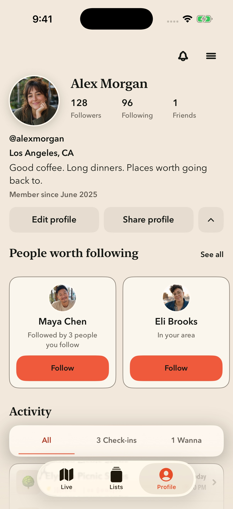
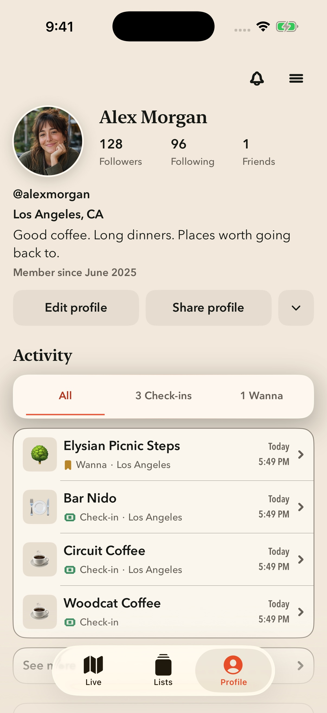
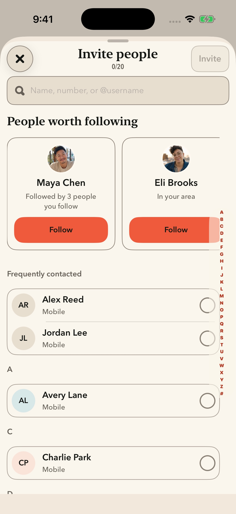

# People worth following — native placement review (REC-682)

This is a DEBUG-only in-app SwiftUI mockup, built from the real `ProfileOwnerHome`, `ContactInviteSheet`, and `PeopleRecommendationCard` components. It uses fictional people and in-memory follow/selection state. Normal app launches and Release builds retain their current behavior.

## Review

Open `Wander.xcodeproj` from this branch and choose **People Placement Review**. The scheme starts with Profile expanded. The small chevron beside Edit profile / Share profile collapses and expands the shelf; its glyph is 12pt and tap target is 44×44pt. **See all** opens Invite people, where the same cards appear above contacts. A sample Follow is reflected on both screens. The header Settings button opens review options, including reset and direct Invite people access.

Direct launch routes:

```text
-WanderPeopleMockup expanded
-WanderPeopleMockup collapsed
-WanderPeopleMockup invite
```

All routes disable live analytics/auth/backend clients through the existing native review path. Contacts are supplied fixtures. The Invite action displays a preview notice instead of sending. People cards open a sample profile. Native scrolling, light/dark appearance, and Dynamic Type remain available. Live and Lists are navigation context only in this focused review.

## Design decisions to review

- Keep the existing Profile identity, social counts, bio, and actions.
- Use the Instagram-style compact action-row disclosure and horizontal suggestion cards below it, with Astir typography, colors, and existing follow controls.
- Collapse removes the entire suggestion section from Profile; Invite people always shows it while the contact search is empty.
- The review opens expanded to expose the design. Default expansion and persistence for production remain part of implementation planning.
- Feed removal is intentionally deferred until the approved implementation. There is no production behavior change in this branch.

## Implementation handoff

After visual approval, create a separate branch from the then-current `origin/main`. Connect both placements to the existing recommendation/follow state, remove the Feed shelf entirely, and reconcile loading/empty/error, account scoping, privacy/block behavior, and analytics attribution. Run the required engineering review and full native test suite for that implementation. Do not carry the mock fixture model, launch routes, or review-only navigation into the production feature.

The review source is `Wander/Features/Profile/PeopleDiscoveryMockups.swift`. Its two insertion points are enclosed in `#if DEBUG` and require a non-nil review environment value. UI checks are in `WanderUITests/PeopleDiscoveryMockupUITests.swift`.

## Native review evidence

| Profile expanded | Profile collapsed | Invite people |
| --- | --- | --- |
|  |  |  |

Captured on iPhone 17 Pro, iOS 26.5. Smaller-screen dark appearance: [Profile](compact-profile-dark.jpg) and [Invite people](compact-invite-dark.jpg), iPhone SE (3rd generation), iOS 26.5. The compact Profile scrolls vertically to the remainder of the page.

Validation on November 9, 2026:

- XcodeGen project generation and native Debug simulator build succeeded.
- All three `PeopleDiscoveryMockupUITests` passed: Profile disclosure/shared Follow/sample profile, Invite search/contact selection/preview-only delivery, and accessibility-size text with a 44pt disclosure target and reachable Follow control.
- Visual review covered expanded/collapsed Profile, Invite placement, light appearance, and compact dark appearance. The Invite carousel stays inside the contact-index lane.
- The full native suite and production integration review are not claimed by this mockup review; they remain required on the later implementation branch.

Re-run interaction checks with scheme `People Placement Review` and `-only-testing:WanderUITests/PeopleDiscoveryMockupUITests`. Complete result bundles stay outside this worktree in the issue-specific local evidence directory; only final small captures are checked in.
